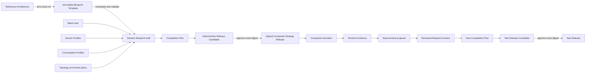
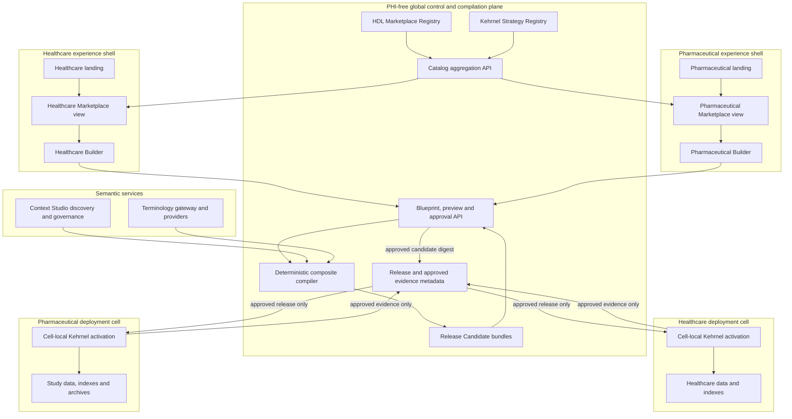

# Kehrnel Evolution: Data Lab Core and the Composite Strategy Compiler

**Status:** Proposed target architecture
**Date:** 2026-09-27
**Current product and repository name:** Kehrnel
**Working architectural role:** Data Lab Core
**Companion experience:** Healthcare Data Lab
**Implementation backlog:** [Data Lab Core execution plan](./data-lab-core-execution-plan.md)
**Portfolio layer:** [Outcome catalog and reference architectures](./outcome-catalog-and-reference-architectures.md)

## 1. Executive decision

Kehrnel is already the strongest foundation for the proposed product. It should
not be replaced with a new generic “business object” framework, and it should
not be renamed yet. It should evolve from a runtime for independently activated
industry strategies into a **deterministic compiler and runtime for composed,
purpose-built data systems on MongoDB**.

The product promise is:

> Describe the data available, the meanings that must be preserved, the ways
> the data must be consumed, and the operational constraints. Kehrnel compiles
> that intent into the smallest justified set of MongoDB data structures,
> access paths, and governed interfaces, then operates it as an immutable
> release.

The output may be a clinical data repository, an operational data layer, an
agent data and memory store, an integration bridge, an analytical hand-off, or
a combination of those. “ODL” is therefore an important workload pattern, but
it is too narrow to be the umbrella product name.

This architecture supports multiple industries without presenting them as one
blended experience. **Healthcare and Pharmaceutical must have
separate user-facing entry points, vocabulary, source landscapes, pattern
catalogs, guided journeys, and defaults.** They share Kehrnel's compiler,
runtime, contracts, and reusable implementation modules underneath.

“Data Lab Core” and a future “Industry Data Lab” are directional descriptions,
not renames committed by this document.

### 1.1 The differentiating thesis

MongoDB's document model is a strong fidelity boundary for hierarchical,
polymorphic, and evolving industry records. Storage fidelity alone does not
make every consumption pattern efficient. Operational applications, standard
protocols, search, graph traversal, analytics, and agents can otherwise create
an uncontrolled collection of duplicate projections and bespoke APIs.

Kehrnel closes that gap. It is a **workload-aware strategy compiler**, not a
generic schema generator:

```text
customer Project Strategy = compile(
  trusted Atomic Strategies,
  Source Profiles,
  semantic and terminology bindings,
  Consumption Profiles,
  topology and policy constraints,
  benchmark and runtime evidence
)
```

The memorable position is:

> **Complex industry data in. Purpose-built MongoDB systems out.**

This does not mean replacing the customer's application estate. Source
applications normally remain authoritative while Kehrnel creates the smallest
selective materialization or operational replica needed for cross-system
workflows, difficult multi-record queries and AI. MongoDB becomes the system
of record only for explicitly selected new or migrated domains.

Concrete application profiles and target strategies are different artifacts.
An OpenMRS/MySQL profile describes an origin and its change behavior; an
openEHR or FHIR strategy describes the MongoDB persistence, indexing, query and
interface contract. Standards are targets unless an actual source emits that
standards-native exchange. Semantics, identity and governed mappings bridge
the two.

Industry discovery begins above concrete applications with product-neutral
Source Categories such as EHR, MPI, laboratory, imaging, EDC, CTMS, safety and
manufacturing. Products are reference implementations used to learn real data
structures and functional interactions; they do not become the primary
architecture taxonomy.

An outcome portfolio sits above those implementation catalogs. It connects an
industry Outcome Pattern and scenario to interaction requirements, Data
Products, a reusable Reference Architecture, exact source/mapping/strategy
evidence, and a Demo Experience. Selecting a Reference Architecture creates a
customer Solution Blueprint; the reference is not itself edited or deployed.
This gallery-to-Builder seam is defined in the
[outcome portfolio design](./outcome-catalog-and-reference-architectures.md).

The first `industry-outcome-catalog/v1` implementation is a single
content-addressed read model: its top-level `artifactRef` covers typed portfolio
domain, Data Product, architecture-capability and visual-pattern definitions
as well as Outcome Patterns, Reference Architectures and Demo Experiences.
Scenarios name their required `interactionIds`; Reference Architectures pin
exact `sourceCategoryRefs` and other executable evidence. The initial nine Demo
Experiences are all `specified`, with no `fixturePackRefs` or
`runEvidenceRefs`, so they remain stories rather than execution claims. The
first pinned Builder hand-off is also implemented: the openEHR CDR Reference
Architecture points to one exact, content-addressed
`solution-blueprint-template/v1`. Instantiation records explicit assumptions,
decisions, and restricted overrides; calculates a deterministic derivation
digest; binds every outcome to a canonical request digest plus the requested
Blueprint identity and revision; and validates the derived
the retired source-blueprint prototype with the source-aware compiler. It does not persist a
project, create a release, or activate a runtime. Canonical-only overrides must
be consistent with their cited assumption paths, and preferred strategies
cannot exceed those pinned by the Reference Architecture. Template integrity
and compiler dependencies fail closed. All current category-only architectures
return `not_instantiable` rather than guessing missing customer choices. The
next portfolio increments are server-derived availability claims, scoped
filters, additional evidence-backed templates, and runnable fixture/run
evidence for individually promoted demos.

The project-specific result contains the authoritative representations,
mappings, query plans, indexes, APIs, agent tools, topology, tests and policies
required by that customer—not every feature Kehrnel happens to support.

### 1.2 The three-layer operationalization contract

Every Atomic Strategy and Composite Strategy should explain three layers:

1. **Authoritative domain records** — standards-native records or bounded
   operational aggregates with source provenance, semantic bindings and
   versions. “One aggregate per document” is used only when document size,
   atomicity and update cadence support it.
2. **Minimal access fabric** — compiled MQL/aggregation, targeted indexes,
   co-located derived fields, Atlas Search/Vector Search indexes, and only when
   justified, sidecar or materialized projections. Every derived structure is
   disposable, versioned, lineage-preserving and rebuildable.
3. **Governed interaction surfaces** — FHIR, AQL, Kehrnel query contracts,
   application APIs, events, exports and MCP tools. Consumers target stable
   contracts rather than physical collections.

Agent decision traces, conclusions and memories are separately governed domain
records. They are not silently mixed into authoritative healthcare or business
records.

### 1.3 Projection economy

Kehrnel should never promise zero projections. It should promise the **minimum
necessary governed access structures**. For each workload it evaluates this
escalation ladder:

1. direct access to the authoritative document;
2. compiled MQL/aggregation plus a targeted index;
3. small co-located computed fields;
4. Search or Vector Search indexes over the authoritative document;
5. a sidecar or materialized projection;
6. a workload-isolated database or external analytical export.

The compiler selects the lowest level that satisfies the workload envelope and
reuses an access structure across compatible consumers. Every derived copy must
name its workload/SLO, owner, consistency mode, freshness and failure behavior,
rebuild source/procedure, version/digest, lineage, migration cost, storage cost,
and write amplification. The optimization objective minimizes copy count,
staleness risk, index fan-out, storage, migration cost, operational complexity
and semantic drift subject to required latency, throughput, conformance,
consistency, residency, retention and security.

MongoDB features are selected because a workload needs them, never to decorate
a demonstration. Change Streams are one maintenance mode, not a default;
Queryable Encryption compatibility must be evaluated against required query,
Search and Vector Search behavior; graph and vector structures are introduced
only with a traceable use case.

## 2. Recommendation in one page

1. Preserve existing Kehrnel strategy packs as trusted **Atomic Strategies**.
2. Add a target-neutral composition layer above them rather than merging their
   standards into one universal canonical object.
3. Compile a user's source, semantic, consumption, workload, topology, and
   policy requirements into a deterministic **Release Candidate**, then wrap
   its approved digest in an immutable **Composite Strategy Release**.
4. Let one governed semantic release serve several workloads through the
   smallest justified access fabric: native FHIR, openEHR/AQL, operational
   application views, agent/MCP tools, search/vector, graph, event, and
   analytical outputs. A materialized projection is a measured decision, not a
   default.
5. Keep YAML as a productive mapping authoring format, but introduce a typed,
   versioned mapping intermediate representation and import/export adapters for
   relevant standards. YAML must not itself be the runtime contract.
6. Use Context Studio for source discovery, polymorphism analysis, semantic
   proposals, and value-set evidence. Use Kehrnel as the runtime authority.
7. Keep terminology as a separately deployable, shared gateway with explicit
   provider and version locks; do not duplicate a terminology server inside
   every solution.
8. Allow LLMs and agents to propose models, mappings, architecture, and tuning,
   but only as typed, evidence-backed diffs. Deterministic validation and human
   approval remain release gates.
9. Add composite activation, multi-cell topology, simulation, runtime evidence,
   and a safe observe → recommend → revise → simulate → approve → release loop.
10. Prove this with one deep Healthcare slice, then a genuinely separate Life
    Sciences slice using the same backend contracts.

## 3. Where Kehrnel is today

Kehrnel is much closer to this target than a conventional schema library. A
strategy already encompasses transformation, persistence, query, operations,
configuration, and explanatory metadata. Existing packs cover openEHR, FHIR,
CDISC, SNOMED CT, ContextObjects, genomics, and X12. Important foundations are
already present:

- typed strategy operations and interaction contracts;
- discovery and loading of strategy packs;
- validated and digested activations with configuration and secret bindings;
- native, compiled, and hybrid interaction models;
- rich openEHR logical, physical, transform, query, and visualization specs;
- AQL compilation and deterministic FHIR index planning;
- a provider-neutral terminology gateway and a native SNOMED CT strategy;
- ContextObject resolution and compilation seams;
- strategy-delegated synthetic generation jobs;
- explain metadata and activation lineage.

The current implementation is strongest as an execution kernel for one
strategy in one domain. It is not yet a composition system.

| Area | Reusable foundation | Missing target capability |
| --- | --- | --- |
| Strategy packaging | Manifests, packs, operations, config and specs | Typed dependencies, provides/requires, conflicts, maturity by capability |
| Activation | Versioned per-domain activation snapshots | A release-level dependency graph activated and rolled back as a unit |
| Models | Strong standard-specific logical and physical models | Target-neutral semantic and mapping contracts across strategies |
| Query | Native and compiled query paths within strategies | Governed cross-strategy routing and federated query planning |
| Mapping | Strategy-specific mappings and Context Maps | Reviewed mapping lifecycle, impact analysis, lineage and runtime evidence |
| Environments | Environment, bindings and API-key scoping | Tenant, legal entity, region, facility, source, residency and purpose context |
| Synthetic data | Asynchronous strategy operations | Coordinated, stateful, multi-source scenarios with deterministic replay |
| Registry | Local manifests, bundles and activation history | Durable, tenant-aware artifact registry, signatures and release promotion |
| Optimization | Strategy-specific index generation | Workload-driven storage, index, shard, Search and Vector Search planning |
| AI | Semantic and assistant seams | Typed proposal protocol, evidence, confidence, approval and evaluation |

Concrete foundation work is visible in the current tree:

- the runtime and SDK now re-export one authoritative `StrategyManifest` model
  from `src/kehrnel/contracts/manifest.py` while retaining their distinct
  plugin ABIs;
- the current manifest digest deliberately omits hydrated config, schemas and
  pack specs, so it is an activation identity rather than a complete
  reproducibility digest (`src/kehrnel/engine/core/manifest_digest.py`);
- most declared operations already have input schemas, but tool safety,
  authorization, purpose, cost and output guarantees are not implied by a JSON
  Schema;
- the current `/agentic` capability probe truthfully reports disabled;
- contract CI now validates the common package foundation and the explicitly
  release-blocking strategy portfolio;
- the existing demo and Docker assets are useful ingredients, but there is no
  single versioned demo-pack contract that joins data, activation, scripted
  interactions, expected traces and reset behavior.

This is a favorable position: the difficult domain work is not discarded. It
becomes the catalog of executable knowledge from which larger systems are
compiled.

Delivery priority is a product policy, not an intrinsic property of a strategy
package. The `strategy-portfolio/v1` contract therefore places openEHR RPS Dual
and its IBM exact-model profile on the primary track, FHIR Resource Store and
CDISC SDR on the supported track, and the remaining current packs on the
preview track. Primary and supported tracks block release. Preview packs remain
safe and discoverable but do not imply the same runtime commitment. The
provider-neutral terminology gateway remains shared infrastructure even while
the standalone SNOMED strategy pack is preview-only.

## 4. Product principles

### 4.1 Preserve plurality; govern composition

FHIR, openEHR, CDISC, enterprise operational models, documents, and agent
memories have different purposes. Kehrnel should not flatten them into one
universal document. It should preserve authoritative native forms and lineage,
establish governed semantic relationships, and create projections optimized
for each declared consumption contract.

### 4.2 Consumption shapes the physical architecture

Sources alone do not determine collections and indexes. The same source data
may require different projections for transactional access, AQL, FHIR search,
agent retrieval, vector search, graphs, cohort analytics, or event delivery.
Every generated choice must trace back to a declared workload.

### 4.3 Compilation is deterministic; intelligence is advisory

Given identical versioned inputs, the compiler must create the same Release
Candidate bytes and digest. Approval principals, timestamps, decisions and
signatures live in the release envelope and are not part of that deterministic
candidate. LLM output is never an untracked build input and never executable
code that is silently installed. Intelligence proposes typed changes with
evidence, confidence, assumptions, and alternatives. Users approve;
deterministic code compiles and validates.

### 4.4 Separate authoring, release, and operation

A mutable design is not a runtime configuration. Publication creates an
immutable release, and activation binds that release to an environment.
Runtime observations can produce an Improvement Proposal; acceptance creates a
reviewed Blueprint revision and a new compilation cycle. Observations cannot
mutate the active release.

### 4.5 Show capability maturity honestly

The complete vision can be designed before every capability is implemented.
Each capability has one visible maturity state:

- **Not assessed** — no reviewed maturity claim exists yet;
- **Specified** — architecture and implications can be shown;
- **Simulated** — works with bounded synthetic scenarios;
- **Compilable** — produces deterministic validated artifacts;
- **Pilot validated** — deployed with evidence under documented constraints;
- **Production validated** — repeatable production evidence exists.

Capability maturity is separate from package lifecycle, commercial/support
commitment, current runtime availability, execution state and the provenance
of an observation. Terms such as alpha, beta, experimental, GA and executed
must not be mixed into one badge. The normative dimensions are:

- `packageLifecycle`: `draft`, `experimental`, `preview`,
  `generally_available`, `deprecated`, or `retired`;
- `capabilityMaturity`: `not_assessed`, `specified`, `simulated`, `compilable`,
  `pilot_validated`, or `production_validated`;
- `supportStatus`: `unsupported`, `evaluation_only`, `supported`, or
  `deprecated`;
- `runtimeAvailability`: `available`, `degraded`, `unavailable`, or `unknown`;
- `executionState`: `planned`, `running`, `executed`, `failed`, or `cancelled`;
- `observationKind`: `measured`, `simulated`, `estimated`, or `illustrative`.

These are recorded per capability as a `CapabilityClaim` with evidence
references. A strategy-wide scalar cannot truthfully summarize capabilities at
different stages. Aggregated catalog summaries are derived server-side from
required claims and expose their contributing and blocking claim IDs; the UI
never promotes a claim on its own.

Legacy `alpha` maps to `experimental`; `beta` maps to `preview`. `Published`
describes visibility, not maturity, and never maps automatically to
`generally_available`. Existing `ga` declarations require a support review
before migration. Legacy `explained`, `pilot`, `supported` and `unavailable`
labels require explicit migration into the appropriate separate dimensions.

## 5. Non-goals

- Do not invent one canonical business object that replaces every standard.
- Do not claim arbitrary natural language can safely generate production data
  architectures without review.
- Do not rebuild licensed or mature external terminology products.
- Do not make the public Builder a path to real customer data without identity,
  tenant, policy, and consent controls.
- Do not make every connector, standard, or query mode a mandatory dependency.
- Do not replace the current single-strategy activation path while composite
  activation is being introduced.
- Do not expose raw cross-database MQL to agents as a substitute for governed
  tools and query plans.

## 6. Canonical vocabulary

The same vocabulary must be used by Kehrnel, Healthcare Data Lab, APIs, and
documentation.

| Term | Meaning |
| --- | --- |
| **Atomic Strategy** | A trusted, executable Kehrnel strategy pack for a bounded concern, standard, model, connector, query mode, or operational behavior. This is the evolution of today's strategy pack. |
| **Outcome Pattern** | A curated industry problem, scenario, actors, success measures and required interactions. It says what should become possible and is neither an application executable nor a customer project. |
| **Reference Architecture** | A curated, reusable, non-executable technical recommendation connecting Outcome Patterns and Data Products to source, mapping, context, Atomic Strategy, interaction and evidence references. **Solution Pattern** is its portfolio-facing UI label in v1. Selecting it creates a Solution Blueprint; the reference is never edited. |
| **Solution Blueprint Template** | An immutable, content-addressed set of complete Blueprint defaults and explicit assumptions pinned by one Reference Architecture. It enables deterministic instantiation; it is neither a mutable customer project nor a deployable release. |
| **Business/Semantic Module** | A reusable, non-executable package of domain meaning, relationships, constraints and presentation metadata that a Reference Architecture or Solution Blueprint may reference. |
| **Industry Experience Pack** | A versioned, substantive industry-content artifact: vocabulary, source taxonomy, modules, default Reference Architectures, semantic/terminology authorities, workload presets, simulations, benchmarks, narrative metadata and one immutable `primaryDemoRef` for each promoted journey. It is not a theme or catalog filter. |
| **Data Product** | A governed logical information boundary with authority, ownership, schema or semantic contract, provenance, sensitivity and lifecycle. It may be stored, virtual, authoritative or derived and can serve several interactions. |
| **Interaction Requirement** | What a person, application, workflow or agent must be able to retrieve, subscribe to, derive, command, coordinate, trace, remember or evaluate, including autonomy, write authority, workload and policy constraints. |
| **Solution Blueprint** | Mutable user intent expressed by the single canonical `solution-blueprint/v1`: participants, interactions, semantic and record authority, data posture, target capabilities, constraints, assumptions, and decisions. |
| **Source Profile** | Evidence about an actual or assumed source: schema and data fingerprints, polymorphism, distributions, volume, change rate, sensitivity, jurisdiction, and evidence references. It contains no raw sensitive records. |
| **Consumption Profile** | Required behavior and workloads for an application, standard protocol, agent, analytics, graph, search, event, or export consumer. |
| **Topology Profile** | Legal tenant, jurisdiction, deployment cell, organization, facility, location, source-instance, residency and federation constraints. |
| **Compilation Plan** | Explainable, non-deployable compiler proposal: selected and rejected strategies, dependency graph, generated assets, alternatives, diagnostics, estimates and unsupported requirements. |
| **Release Candidate** | Deterministic, content-addressed compiled bundle of locked strategies, semantics, mappings, models, APIs, plans, tests and provenance. Identical inputs produce the same candidate bytes and digest. It is not deployable until approved. |
| **Composite Strategy Release** | Immutable approval envelope that identifies one exact Release Candidate digest and records approval and policy evidence. It is called signed only when a versioned trust profile is implemented. Approval timestamps and principals belong to this envelope, not to the deterministic candidate. |
| **Atomic Strategy Activation** | Today's activation of one Atomic Strategy for an environment/domain; retained as a backward-compatible primitive and child of composite orchestration. |
| **Composite Activation** | One approved Composite Strategy Release bound to an Environment, solution namespace, secrets, connections, infrastructure and policy decisions. |
| **Demo Experience** | A versioned, read-only narrative or demonstration of an Outcome Pattern and Reference Architecture. A `specified` storyboard is not a completed run. `simulated` or higher maturity requires both an exact fixture-pack reference and completed-run evidence; public presentation must label the evidence honestly. |
| **Runtime Evidence** | Versioned observations for freshness, mapping coverage, drift, query/index performance, terminology, policy, audit, SLOs and cost. |
| **Tenant** | The legal, security, ownership and isolation boundary. |
| **Workspace** | A collaboration container within exactly one Tenant; it owns drafts, memberships and approval workflows but is not a runtime boundary. |
| **Environment** | A runtime boundary within one Tenant, such as sandbox, test or production, with bindings and deployment policy. |
| **Personal Sandbox** | An automatically provisioned, authenticated, synthetic-only Tenant/Workspace for individual exploration; it cannot connect private production data or become an organization tenant implicitly. |

The existing FHIR cohort use of “blueprint” remains namespaced. API contracts
must always use the full name **Solution Blueprint** and the machine kind above.

## 7. Artifact lifecycle



Important state rules:

- A Reference Architecture can be instantiated only when it pins an exact
  Blueprint Template. Otherwise the hand-off returns `not_instantiable` and
  invents no source, ingestion, workload, or topology details.
- Instantiation is deterministic and side-effect free. It validates the
  derived Blueprint through the compiler but does not save it, create a
  Compilation Plan, publish it, or activate it.
- Every result carries the canonical request digest, requested Blueprint ID,
  and revision as well as its derivation digest. Overrides cannot contradict an
  accepted assumption, cite an unrelated assumption, or select a preferred
  strategy outside the exact Reference Architecture boundary.
- Invalid template integrity or unavailable source, mapping, or strategy
  catalogs fail closed as dependency errors; callers never receive a partial
  Blueprint from unavailable runtime knowledge.
- “Save design” creates or updates a Solution Blueprint.
- “Publish as Solution Pattern” creates a reviewed Reference Architecture and
  is a separate action with its own ACL and
  version. It never happens as a side effect of saving.
- The instantiation result records the exact Reference Architecture and
  template versions plus assumptions, decisions, and the user's override diff;
  the retired source-blueprint prototype remains internal to historical tooling.
- A compilation plan is inspectable and rejectable, not deployable.
- Compilation creates a deterministic Release Candidate. Approval of its exact
  digest creates a signed release envelope; deployment never follows mutable
  catalog entries.
- The same release can be activated in sandbox and production using different
  bindings without changing its candidate digest.
- Mapping, semantic, index, or API changes create a reviewed Blueprint revision,
  candidate and release.

## 8. Target architecture



Healthcare and Pharmaceutical are separate experience packages or deployments,
not tabs inside a mixed industry model. Shared capabilities such as identity,
documents, ingestion, terminology, agents, and simulation are reused by
reference behind those experiences. A neutral corporate chooser may route a
visitor to one of them, but each experience then uses an exact
`experiencePackId`, version and digest on catalog, Blueprint, and Experience
requests.

## 9. Product boundaries

### Healthcare Data Lab owns

- the light-theme Builder and experience-scoped Marketplace, both before and
  after authentication;
- the authenticated dark-theme Operate experience;
- user, tenant, workspace, collaboration and approval workflows;
- browsing, cloning and publishing Outcome Patterns and Solution Patterns
  (`ReferenceArchitecture` artifacts);
- explanations, comparisons, generated experiences and storytelling;
- collection of intent and display of compiler evidence.

The **HDL Marketplace Registry** ultimately owns Outcome Patterns, Reference
Architectures, Business/Semantic Modules, Industry Experience Packs, Demo
Experiences, ACLs and presentation metadata. The first Kehrnel catalog endpoint
may publish their deterministic shared read model while this registry boundary
is introduced.

### Kehrnel owns

- the authoritative atomic-strategy and capability catalog;
- validation of portable Reference Architecture packages;
- dependency and constraint resolution;
- deterministic compilation and content digests;
- preflight, tests, simulation execution and evidence;
- activation, runtime routing, ingestion, query and operations;
- release-level telemetry and safe optimization proposals.

The **Kehrnel Strategy Registry** owns Atomic Strategies and their executable
capability truth. A **Catalog Aggregation API** joins allowed, versioned records
from both registries into the consistent read model used by Marketplace and
Builder. Aggregation does not transfer execution authority to HDL or ACL
authority to Kehrnel.

### Context Studio owns

- profiling existing structures without copying sensitive data into design
  artifacts;
- detection and review of polymorphic families;
- semantic concept and relationship proposals;
- value-set observations and mapping evidence;
- governance and publication of accepted semantic artifacts.

### Terminology gateway owns

- stable terminology operations across native and external providers;
- provider routing, capability evidence and version locks;
- value-set validation, expansion, subsumption and code lookup where supported.

Context Studio does not become the runtime, and the terminology gateway does
not become the semantic mapping workbench.

Theme is not an authorization signal. Tenant, workspace, environment, release,
and data classification remain explicitly labeled in both modes. Shared mode
tokens and accessibility behavior are distinct from the Healthcare or Life
Sciences accent tokens supplied by an Industry Experience Pack.

## 10. Core contracts

All artifacts are versioned, content-addressed, attributable, and schema
validated. Suggested first contracts are:

### Shared references, claims and graph

- `artifact-ref/v1` always carries `kind`, `id`, `version` and `digest`;
- package, contract, composition and candidate digests remain distinct from an
  HTTP representation `ETag`;
- `CapabilityClaim` records capability maturity, support, runtime availability
  and evidence references per capability;
- `artifact-graph/v1` supplies stable typed node/edge IDs, artifact references,
  evidence/redaction state and trace-step references for every visual lens.

The browser does not reconstruct dependency, lineage or support state from
names. Every execution request pins its inputs with artifact references and
fails closed on a digest mismatch.

### `solution-blueprint/v1`

- identity and exact `experiencePackId`, version and content digest;
- desired outcomes and success measures;
- source intents and source-profile references;
- semantic authorities and terminology policy;
- interaction requirements/profiles and workload envelopes;
- topology, residency, security and federation policy;
- selected Reference Architecture references and explicit overrides;
- assumptions, unresolved decisions and user approvals.

### `industry-experience-pack/v1`

- stable ID, industry identity, version, publisher and content digest;
- vocabulary, source taxonomy and Business/Semantic Module references;
- default Reference Architecture, semantic-authority and terminology-policy
  references;
- promoted Solution/exhibit references and exact compatible Atomic Strategy
  artifact refs; Atomic Strategies publish domains, capabilities and contract
  ranges but do not depend on this presentation pack;
- consumption/workload presets, simulations and benchmark references;
- narrative, iconography, documentation and experience-specific accent tokens;
- compatibility with Blueprint, catalog and compiler contract versions.
- one immutable `primaryDemoRef` and selected clinical strategy reference for
  each promoted public journey; alternatives remain explicitly planned or
  unavailable until proven.

The pack contains governed industry knowledge and presentation metadata, not
executable runtime code. Atomic Strategies remain in the Kehrnel Strategy
Registry.

### `source-profile/v1`

- source type, product/version and connector hints;
- schema and sample-derived fingerprints;
- polymorphic families and observed value distributions;
- volume, velocity, change semantics and retention;
- jurisdiction, sensitivity and residency classification;
- evidence references and confidence, never embedded PHI or secrets.

### `compilation-plan/v1`

- selected and rejected Atomic Strategies with reasons;
- resolved dependency graph and detected conflicts;
- proposed semantics, mappings, projections and topology;
- generated API, query, index, Search, Vector Search and event assets;
- architecture alternatives, estimates and benchmark evidence;
- diagnostics, unsupported requirements and required approvals.

### `composition-lock/v1`

- component artifact/package/contract references and digests;
- terminology provider and release bindings;
- interaction bindings, policy reference and compatibility decisions;
- one deterministic composition digest referenced by every composed demo.

### `query-plan-trace/v1` and `query-run-trace/v1`

- the content-addressed plan is a typed step DAG with stable step IDs, parent
  references, per-step artifacts, expected inputs/outputs and evidence;
- the volatile run envelope carries correlation/timing/metric observations,
  policy decision, bounded result summary and citations;
- timestamps, generated IDs and measurements never alter deterministic plan
  content.

### `demo-pack/v1` and `demo-evidence-package/v1`

- a demo pack pins its strategy/composition refs, data checksums, scripted
  interactions, expected assertions, quotas, reset policy and deployment modes;
- every dataset and terminology dependency declares license/version and
  redistribution status;
- the evidence package is a redacted, pinned, non-deployable M0 export;
  deployable take-home bundles are separately approved release artifacts.

### `composite-strategy-candidate/v1`

- blueprint, Industry Experience Pack, Reference Architecture and
  source-profile digests;
- locked strategy, package and terminology versions;
- semantic-decision and mapping locks;
- generated model, query, API, index, search, vector and simulation artifacts;
- compatibility, migration and rollback plan;
- tests, benchmark thresholds and provenance;
- one deterministic content digest.

### `composite-strategy-release/v1`

- the exact Release Candidate digest;
- approval decision, scope, principal and policy evidence;
- versioned trust profile, canonical signed bytes, algorithm, key ID, trust
  root, signature, rotation and revocation metadata;
- promotion and revocation status.

Until that trust profile and verification API exist, the artifact is an
immutable **approved envelope**, not a signed release.

### `runtime-evidence/v1`

- activation and connector/CDC state;
- freshness, lag, mapping coverage and drift;
- query, index, Search and Vector Search performance;
- terminology and embedding freshness;
- policy decisions, audit events, SLOs and cost indicators;
- recommendations linked to supporting observations.

No secret values or raw source samples belong in these portable artifacts.

## 11. Manifest v2 and composition

The current manifest should remain readable. An additive v2 contract should
introduce:

- an `operationalization` block with `authoritativeRepresentations`,
  `accessStructures`, and `interactionSurfaces`;
- typed `provides` and `requires` capabilities;
- semantic inputs and outputs;
- supported source and consumption profile kinds;
- dependency version ranges and optional dependencies;
- conflicts, exclusivity, coexistence and precedence rules;
- generated artifact types;
- topology and deployment constraints;
- policy and terminology requirements;
- capability-level maturity and evidence;
- workload envelopes and benchmark references;
- migrations and compatibility declarations.

Every access structure declares `servesWorkloads`, its authoritative rebuild
source, consistency/freshness mode, lineage, cost estimate and retirement
condition. Every interaction surface points to the access structures it may use
and the policy context it requires.

An additive `explain.mongodb` section supplies the generic product evidence
needed by HDL:

- representative authoritative document and document-boundary rationale;
- optional, explicitly qualified relational decomposition for comparison;
- standard/native query and compiled MQL or aggregation;
- selected index/Search/Vector Search definition and execution evidence;
- MongoDB capabilities actually used in that path;
- lineage, rebuild behavior, assumptions and capability evidence status.

The comparison must be factual and tied to the demonstrated model/query. It
must not assume every relational design is EAV or claim measured superiority
without reproducible evidence.

An Atomic Strategy may contribute only one part of a release: for example a
FHIR persistence strategy, an AQL compiler, a terminology provider, an MPI
resolver, a CDC connector, a document extractor, an agent-memory projection,
or an index policy. The composite compiler chooses and connects them. The
release references signed, reviewed implementations; it does not synthesize
arbitrary Python modules.

## 12. Compiler pipeline

The compiler is staged so every decision can be inspected.

1. **Normalize intent.** Validate the blueprint and expand Reference
   Architecture references without losing the user's override diff.
2. **Resolve capability dependencies.** Select compatible Atomic Strategies,
   record rejected alternatives, and surface unsatisfied needs.
3. **Resolve semantics.** Join accepted concepts, polymorphic families,
   terminology bindings and authoritative native representations.
4. **Plan mappings.** Build executable mapping graphs, validation rules,
   lineage, error handling and change-impact information.
5. **Plan authoritative storage.** Choose databases, collections, bounded
   document boundaries, references/embedding, history, retention and archives.
6. **Plan the minimal access fabric.** Apply the projection-economy ladder and
   derive only the indexes, computed fields, materialized views, shard keys,
   Search, Vector Search, graph adjacency and caching justified by declared
   workloads.
7. **Check topology and policy.** Enforce residency, tenant isolation,
   sensitivity, consent/purpose constraints and federation rules.
8. **Generate interfaces.** Produce supported APIs, protocol endpoints,
   governed agent tools, query contracts, events and exports.
9. **Generate simulation and tests.** Build deterministic scenarios, contract
   tests, data-quality checks, migration checks and performance thresholds.
10. **Produce diagnostics.** Explain every decision, unsupported requirement,
    assumption, risk and alternative before approval.
11. **Freeze the candidate.** Lock versions and produce a deterministic Release
    Candidate only after successful validation.
12. **Approve the digest.** Reviewers approve the exact candidate digest; the
    system then creates the signed Composite Strategy Release envelope.

Every consumption route must expose the chain:

```text
consumer -> interaction contract -> access structure -> authoritative record
  -> mapping/provenance -> source
```

## 13. Mapping architecture

The current YAML direction is sound as an authoring experience: it is readable,
diffable, reviewable, and works well for accelerator teams. It should not be the
only representation or become a MongoDB-only mapping language that cannot
interoperate with industry tooling.

Kehrnel should define a typed **Mapping IR** serialized as canonical JSON/BSON;
YAML is one lossless authoring view. The IR should model:

- source and target selectors with explicit model/version identity;
- semantic identity and terminology bindings;
- transform expressions, preprocessing and reusable functions;
- conditional, repeating, polymorphic and zero/one/many mappings;
- joins, reference resolution, deduplication and identity matching;
- defaults, validation, lossiness and reversibility;
- provenance down to target field and source evidence;
- error/dead-letter behavior and quality thresholds;
- batch, streaming and CDC execution semantics;
- expected volume, cost and performance characteristics;
- tests, fixtures, ownership, approval and effective interval.

Adapters should import or reference appropriate external artifacts rather than
forcing users to rewrite them: FHIR StructureMap/FHIR Mapping Language where it
fits, FHIR profiles and search parameters, openEHR archetype/template paths,
CDISC metadata, JSON transformation tools, and lineage/event standards. No
single external mapping standard spans all of these domains, so the internal IR
is justified. It must preserve the original artifact and declare any semantic
loss during import or export.

Mappings are first-class release assets. They are compiled for the selected
runtime, tested against synthetic and approved samples, monitored for drift,
and versioned independently before being locked into a Composite Strategy
Release.

## 14. Semantics, polymorphism and terminology

Context Studio contributes high-value capabilities that should be modular, not
mandatory for every deployment:

- discover structures and observed shapes in legacy sources;
- identify polymorphic families and discriminator behavior;
- propose semantic concepts and relationships;
- distinguish observed values from authoritative value sets;
- propose mappings and terminology bindings with evidence;
- allow experts to approve and publish reusable semantic packs.

Terminology is a critical logical service but should remain separately
deployable. Kehrnel already has the correct foundation: a provider-neutral
gateway plus specialized providers, including the native SNOMED strategy and
customer-selected external FHIR terminology servers.

A binding must include an applicability envelope, not only a code-system URL:

- tenant, organization, facility and region/jurisdiction;
- source system and version;
- language and effective interval;
- purpose and priority;
- provider and terminology release lock;
- original local code plus zero, one, or many canonical concepts;
- mapping relation, loss, confidence, provenance and approval.

The compiler pins accepted bindings and provider capabilities into the release.
Observed values can generate a review queue; they never silently become an
authoritative terminology.

Terminology enrichment must not rewrite a standards-native authoritative
payload. Ancestor IDs, normalized concepts, embeddings and similar derived
values belong in a reserved, versioned envelope or rebuildable access structure
with an explicit terminology-release dependency.

Terminology licensing is an execution gate. A promoted demo can name SNOMED
only when its version-locked provider is legally accessible in that deployment.
A licensed remote provider is valid but must be declared as a prerequisite;
fictional terminology may support development but must never be presented as
SNOMED or as satisfying the public proof.

## 15. Sources, ingestion and CDC

Connectors are modular adapters behind a stable source contract. Kehrnel should
support batch, event, CDC and file/object-store inputs without coupling the
compiler to one vendor. A source module declares:

- discovery/profiling capability;
- snapshot and incremental semantics;
- ordering, replay, idempotency and delete handling;
- schema/version-change behavior;
- credential and network requirements;
- provenance, watermark, lag and reconciliation evidence;
- supported deployment cells and residency constraints.

Mapping begins after capture of immutable source identity and lineage. The same
mapping graph may have batch and streaming execution plans, but their
equivalence must be testable. Source drift creates diagnostics and a proposed
new release; it does not rewrite a running mapping silently.

## 16. Consumption profiles and workload projections

Initial consumption profile families should include:

- operational application reads and writes;
- FHIR read, search, history, subscription and terminology interactions;
- openEHR contributions and AQL;
- integration/bridge and event delivery;
- analytics, cohorts and exports;
- governed agent tools and MCP resources;
- Atlas Search and Vector Search;
- graph traversal and relationship queries;
- archive and object-storage access.

Each profile declares query shapes, consistency, latency, throughput, freshness,
history, security, scale and failure expectations. The compiler then proposes
the smallest justified set of projections and indexes. It must not add vector
search, graphs, or duplicated collections merely because they are available.

Canonical queries are durable contracts. AQL or FHIR search can compile into
optimized MongoDB operations while retaining the original query, compiler
version, generated plan and trace. MongoDB-native aggregation, `$graphLookup`,
Search and Vector Search remain available through governed contracts when they
provide value beyond a standard protocol.

## 17. Agentic data and interactions

Agents need more than conventional business objects. A solution may include:

- episodic memories and interaction traces;
- procedural memories and approved playbooks;
- conclusions, evidence references and confidence;
- pending decisions, actions and human approvals;
- embeddings and retrieval metadata;
- short- and long-term retention policies.

These are separate modules with explicit lifecycle and policy, not fields
silently appended to clinical or business records. Agent tools are generated
from approved consumption contracts. Every operation carries principal,
tenant, purpose of use, policy decision, sensitivity/consent context, and
read-versus-write risk. Write or external-action tools require stronger
approval policies than read-only retrieval.

One MCP server can expose a large governed tool surface, so MCP-server count is
not the architectural unit. The important units are typed tools, resources,
policy boundaries, audit evidence, budgets, and release versioning. Cross-domain
questions go through a release-aware router/federation planner rather than raw
database access.

The first generated agent surface is deliberately read-only and allowlisted.
An operation's input schema is necessary but insufficient for publication as a
tool. Its descriptor must also declare output schema, authorization scopes,
purpose-of-use constraints, sensitivity, pagination/result limits, timeout and
cost budget, idempotency, write/external-action risk, citation behavior and
evaluation evidence. Kehrnel can coexist with MongoDB MCP transport and database
capabilities while owning the industry semantics and policy contract.

Anonymous interactions use a server-injected synthetic demo identity and a
short-lived session capability for every status, event, cancellation and
evidence request. Public Ask defaults to curated intents. If constrained free
text is enabled, suspected sensitive content is rejected or redacted before a
model call; the provider boundary and retention policy are explicit, and raw
prompts never enter durable traces, logs or exports.

## 18. Simulation

Simulation should evolve from independent synthetic jobs into a deterministic
scenario graph:

- multiple sources emit temporally coordinated events;
- identities and relationships remain consistent across EHR, MPI, scheduling,
  laboratory, imaging, billing and documents;
- mappings and projections run through the same compiled paths as live data;
- scenarios support seed, clock, scale, geography, facility and anomaly knobs;
- replay produces the same logical evidence for the same locked inputs;
- workload drivers exercise APIs, AQL, FHIR search, agent tools, graph and
  analytics;
- quality, performance, privacy and failure evidence is retained.

Public demonstrations use only synthetic or explicitly public structural data.
Their preview simulation runs in a bounded PHI-free service. Connecting or
sampling tenant data requires authentication and policy checks; validation,
load simulation and workload replay using tenant structures or data execute in
the approved deployment cell and return only permitted evidence to the global
control plane.

## 19. Multi-tenant and multi-location topology

Tenant is not synonymous with hospital or location. The target topology must
model independent axes:

```text
consortium/network
  -> legal tenant
    -> jurisdiction/deployment cell
      -> organization/facility/location/department
        -> source system instance
```

The preferred architecture is a PHI-free global control plane with regional,
hospital, or study data cells. Releases are portable; activations bind them to
cell-local connections and policies. Cohort execution is pushed to permitted
cells and returns only approved results. Cross-tenant access is opt-in and
policy governed, never implied by network membership.

Tenant evidence remains tenant-local by default. Cross-tenant benchmarks or
learning require explicit opt-in, aggregation/de-identification, minimum cohort
thresholds, provenance and revocation rules. No raw records, secrets, unique
source fingerprints or organization-identifying telemetry may train or inform
another tenant's recommendations.

The compiler must evaluate residency, key management, encryption, retention,
archive tiering, data minimization, purpose of use, consent and de-identification
before proposing a topology. Tenant isolation is enforced in Kehrnel runtime
contracts as well as in the Data Lab user interface.

## 20. Composite activation and operation

Existing per-strategy `plan/apply` and activation snapshots are useful
primitives. Composite activation adds a parent orchestrator that:

1. validates the full release and environment bindings;
2. merges atomic plans and detects database, collection and index conflicts;
3. executes a dependency DAG with preflight and health gates;
4. records an environment-level release pointer and component activations;
5. supports staged/canary rollout where allowed;
6. compensates partial failures or restores the previous release as a unit;
7. never exposes a half-activated release as healthy.

An Environment may host more than one Composite Activation only when each has a
unique solution namespace and the compiler proves that databases, collections,
indexes, routes and shared dependencies do not conflict. Shared resources must
be explicitly declared and version locked; otherwise activation is rejected.

Operate closes the learning loop through design review:

```text
Observe -> Recommend -> Blueprint revision -> Compile -> Simulate
  -> Approve candidate digest -> New Release -> Activate
```

Recommendations can include an index, mapping, projection, topology, capacity,
or connector change. They carry evidence, expected benefit, risk and rollback
information. Accepting one creates a reviewed Blueprint revision; it never
jumps directly from telemetry to a release.

## 21. Intelligence and approval model

LLMs and agents are valuable in five bounded roles:

1. explain a source, standard, strategy or compiler decision;
2. propose semantic matches, mappings and transformations;
3. recommend Reference Architectures, architecture alternatives and
   interaction profiles;
4. generate candidate query/index plans and simulation scenarios;
5. summarize runtime evidence and recommend optimizations.

Every proposal must include structured output, input evidence references,
confidence, assumptions, alternatives, affected artifacts, tests and required
approval. The system validates the proposal against schemas, policies,
capability constraints and deterministic tests. Natural-language approval is
acceptable only when the interface shows the exact structured diff being
approved and records the approving principal.

The system must clearly distinguish:

- deterministic facts derived from catalogs or source profiles;
- heuristic recommendations;
- model-generated assumptions;
- unsupported requirements.

## 22. Registries, catalog aggregation, and APIs

The two registries and their aggregation API separate portable core artifacts
from control-plane metadata:

- MongoDB-curated Reference Architecture packages are portable, signed and
  core-validated.
- Tenant Reference Architecture drafts, ACLs, collaboration and marketplace presentation live
  in the Data Lab control plane.
- Atomic Strategies and capability evidence live in the Kehrnel Strategy
  Registry; published Outcome Patterns, Reference Architectures, Modules,
  Industry Experience Packs and Demo Experiences live in the HDL Marketplace
  Registry.
- HDL stores `visibility`, `verification`, and `publicationState` as separate
  fields; none is inferred from package lifecycle, capability maturity,
  support status or runtime availability.
- Marketplace and Builder use the same Catalog Aggregation API and pinned
  references, not a duplicated registry.
- Releases pin artifact content digests and never follow mutable Reference
  Architecture tags.
- Environment bindings and secrets remain outside portable releases.

One unscoped, public discovery call—conceptually
`GET /api/experience-packs`—lists available Industry Experience Packs for the
neutral chooser. After selection, every downstream catalog, Blueprint and
Experience call carries an `experiencePackId` and version; compilation and
release records additionally pin its content digest.

Design-level API families:

- public read-only catalog, Reference Architecture, compile-preview and
  synthetic simulation,
  restricted to public/synthetic profiles and bounded ephemeral execution;
- authenticated blueprint and source-profile management;
- compilation creation, diagnostics and alternatives;
- approval and release publication;
- environment preflight, activation, status, rollback and evidence;
- recommendation proposal, acceptance and rejection.

Kehrnel does not own browser sessions or tenant membership. The control plane
passes verified, scoped identity and policy context.

Anonymous structural imports remain browser-local or enter an explicitly
ephemeral sandbox. They cannot create a Release Candidate, release, persistent
source profile, private connection or activation.

## 23. Versioning and compatibility

Four changes must be distinguished:

1. source schema/product versions;
2. canonical standard, profile, archetype and terminology versions;
3. Kehrnel Atomic Strategy and compiler versions;
4. tenant blueprint, mapping, policy and topology versions.

The Release Candidate lock records all four. The compiler performs impact analysis and
creates an explicit migration plan: compatible in-place change, side-by-side
projection, backfill/reindex, dual-read/write, or breaking migration. Runtime
data provenance records the mapping and release that produced each governed
projection. A candidate cannot be described as reproducible if its digest omits
relevant config, specs, mappings or generated artifacts.

## 24. Separate industry experiences, shared core

The first two experiences validate the architecture without conflating their
stories.

### Healthcare experience

Uses healthcare language and presents EHR, MPI, scheduling, emergency,
laboratory, PACS/imaging, devices, billing/claims, pharmacy and clinical
documents. It offers healthcare Solution Patterns, terminology, FHIR,
openEHR/AQL, clinical application, patient-flow, cohort and agent consumption.

### Pharmaceutical experience

Uses pharmaceutical language and presents studies, sites, subjects, EDC,
ePRO/eCOA, laboratory, safety, regulatory, manufacturing/quality, supply and
scientific content. It offers study, evidence, safety, regulatory and research
Solution Patterns with CDISC and relevant terminology.

These may be separate frontend/configured experience-shell deployments over the
same backend service plane. Only residency- or isolation-driven runtime cells
are independently deployed. A user in one experience must not encounter the
other industry's taxonomy by default. Adding a new industry experience must
require new packages and presentation metadata, not a new compiler or runtime
fork.

A neutral MongoDB or future Industry Data Lab page may ask a visitor to choose
an industry and then route them into a separate experience. It must not merge
the catalogs, vocabulary or Builder workflow after that choice.

## 25. Delivery plan

### Phase 0 — Make the existing strategies product-grade inputs

- Consolidate the runtime and SDK manifest contracts and validate every pack.
- Add the three-layer operationalization contract and `explain.mongodb`.
- Complete digests across manifests, schemas, specs, mappings, templates and
  packaged implementation artifacts.
- Add automated test execution to CI and deterministic golden UI fixtures.
- Map legacy maturity labels into the separate lifecycle, capability maturity,
  support, availability and evidence dimensions through explicit review.
- Define stable exhibit, query-trace, demo-pack, agent-tool, Blueprint,
  Compilation Plan and runtime-evidence schemas.

### Phase 1 — Zero-setup, explainable Atomic Strategies

- Package versioned, deterministic synthetic demos for openEHR, FHIR and
  SNOMED CT; expose CDISC only through the separate Pharmaceutical experience.
- Provide a one-command local demo and a protected, read-only public demo API
  with no exposed database credentials.
- Return an end-to-end trace from standard query through compiled MQL, selected
  access structure/index, result and provenance.
- Supply the factual “why MongoDB” evidence generically from manifests rather
  than hardcoding strategy-specific UI copy.

### Phase 2 — First real composition and governed agent surface

- Add a small `provides`/`requires` dependency resolver.
- Compose SNOMED terminology/subsumption with the most complete runnable
  clinical strategy first; repeat through the same contract for the second
  clinical standard rather than pretending both are already unified.
- Generate an allowlisted, read-only governed tool surface from eligible
  strategy operations, with principal, purpose, policy, limits, citations and
  trace output. Coexist with MongoDB MCP infrastructure; Kehrnel owns the domain
  semantics and constraints.
- Prove one clinical-meaning question end to end and persist its evidence-linked
  decision trace as a separate governed record.

### Phase 3 — Customer-shaped sandbox and “take it home”

- Add Consumption Profiles and a compilation preview that applies the
  projection-economy ladder and explains rejected alternatives.
- Restrict Source choices to prepackaged profiles with existing, approved
  strategy-local mappings; novel schemas and generated mappings are not M1.
- Add deterministic Release Candidate locks, an immutable approved sandbox
  envelope (signed only after the trust profile is implemented), preflight and
  reproducible local/Atlas sandbox packaging.
- Emit an architecture/evidence bundle and governed MCP configuration.
- Provide a narrow, read-only runtime-evidence view; do not claim a production
  operating platform yet.

### Phase 4 — Multi-source Healthcare system proof

Compile **Referral and Diagnostic Follow-up** from EHR, MPI, scheduling, LIS,
PACS, billing and documents. Add the typed Mapping IR with YAML as an authoring
view, batch/CDC mapping plans, coordinated simulation, operational application
access, FHIR/AQL, governed agents, graph/analytics and whole-release activation.
This is the next system-level acceptance test, not the first public
demonstration.

### Phase 5 — Production pilot and Operate

- Prove isolation, residency, audit, SLOs, failure recovery and scale.
- Add federated multi-hospital cohort execution under explicit policy.
- Validate upgrades of standards, terminology, mappings and indexes.
- Add mapping drift, optimization proposals, composite rollback and durable
  operations evidence.
- Publish support envelopes per capability.

### Phase 6 — Separate Pharmaceutical validation

Create a **Study and Safety Evidence** experience with its own vocabulary,
source map, catalog and narrative. Use the same blueprint, compiler, mapping,
release, activation and evidence contracts. Any required backend fork is a
design failure and should be addressed at the module boundary.

### Phase 7 — Additional industry experiences

Add industries only after the first two demonstrate that shared interfaces are
stable. Each new experience supplies its own source ontology, Outcome Patterns,
Reference Architectures, terminology bindings, workflows, benchmarks and story
while reusing the core.

## 26. Priority and confidence

| Decision | Conviction | Priority | Reason |
| --- | ---: | ---: | --- |
| Evolve Kehrnel rather than start a new core | 95% | Now | Existing executable domain knowledge is the differentiator. |
| Separate industry experiences on one backend | 95% | Now | Users need their own language; shared contracts prevent duplication. |
| Three-layer strategy contract and MongoDB evidence | 95% | Now | Makes the implemented differentiation visible and reusable by every experience. |
| Deterministic demo packs and end-to-end traces | 95% | Now | Creates immediate proof without customer setup. |
| First terminology-plus-clinical composition | 90% | Now | Demonstrates real reuse without requiring a generic N-strategy compiler first. |
| Governed read-only agent tools | 90% | Now | Makes the agentic value tangible while preserving policy and audit. |
| Consumption-aware compiler and projection economy | 95% | Next | Solves the hard gap between document fidelity and efficient consumption. |
| Typed mapping IR with YAML authoring | 90% | Next | Preserves current velocity while enabling governance and interoperability. |
| Existing terminology gateway and Context Studio contract seam | 90% | Now | Stabilize the boundary without pulling discovery into the runtime. |
| Context Studio import and governed AI proposal service | 85% | Later / KDL-013 | Valuable after the deterministic compiler and Mapping IR exist. |
| Composite releases and production Operate | 90% | Later | Essential destination, but credibility depends on the smaller executable proof first. |
| AI-assisted mapping and architecture proposals | 80% | Later / KDL-013 | High leverage after typed diffs, evaluation and approval contracts exist. |
| Fully autonomous production ODL generation | 45% near term / 85% direction | Later | Valuable north star; premature without deterministic contracts and evidence. |
| Broad third-party marketplace | 65% | Later | Useful after package trust, compatibility, signing and support are solved. |

## 27. Milestone and target-platform acceptance

### M0 — See + Ask

M0 succeeds when one readiness-selected clinical strategy composes with a
license-cleared terminology path, an anonymous visitor can inspect it and ask
one governed read-only question, the multi-step query/lineage trace is backed
by executable evidence, and a pinned redacted evidence package can be exported.
The other clinical protocol is visibly planned/unavailable until independently
proven.

### M1 — Shape + Prove + Take it home

M1 succeeds when a prepackaged Source with an existing executable mapping, or a
supported Use/workload change, produces an explainable Compilation Plan,
deterministic simulation and reproducible local or Atlas sandbox artifact, with
sign-in required only for persistence or real-world action.

### Target platform

The complete architecture is successful when:

1. both repositories use the same lifecycle and glossary;
2. current strategy packs are represented as backward-compatible Atomic
   Strategies;
3. Reference Architecture selection creates a blueprint and never edits the
   reference;
4. publishing a tenant Solution Pattern is distinct from saving a design;
5. identical inputs and digests produce a byte-stable Release Candidate, while
   approval metadata lives in its signed release envelope;
6. unsupported requirements fail visibly with actionable diagnostics;
7. every endpoint traces to its source, mapping, storage and index decisions;
8. LLM proposals include evidence and cannot bypass validation or approval;
9. semantic, mapping and index changes create a Blueprint revision, new
   candidate and new immutable release;
10. one release activates in sandbox and production with different bindings;
11. a composite rollout is atomic or safely compensated and rolls back as a
    whole release;
12. a multi-hospital scenario proves tenant, cell, facility and source are
    distinct topology concepts;
13. Operate telemetry can create, but never silently apply, an optimization
    proposal;
14. a separate Pharmaceutical experience can be added without changing the
    compiler's conceptual model or sharing a mixed post-entry catalog;
15. all post-chooser artifacts and catalog calls pin an Industry Experience
    Pack ID/version, and Release Candidates pin its digest;
16. cross-tenant evidence cannot be reused without explicit opt-in and the
    aggregation, privacy and provenance gates in this design;
17. every materialized access structure names the workload/SLO that justifies
    it, its costs and its rebuild/retirement behavior;
18. every displayed MongoDB claim is backed by manifest or runtime evidence;
19. one governed read-only clinical tool executes a terminology-aware query
    with an end-to-end trace;
20. existing single-strategy activations continue to work.

## 28. Naming decision

Keep **Kehrnel** as the repository and implementation name during this
evolution. Describe its target role as **Data Lab Core** where a product-level
label is useful. Avoid “ODL” as the umbrella because the compiled result may be
an ODL, CDR, agent store, evidence repository, integration bridge, or a composed
system containing several of them.

Before a broader launch, validate a name against four tests: it must be
multi-industry, describe governed composition rather than one data shape, work
for both builders and operators, and be ownable inside MongoDB. The architecture
should not depend on that naming decision.

## 29. Final assessment

Kehrnel is directionally correct. The main need is not a cosmetic repackaging,
but neither is it a restart. Preserve the deep standard-specific strategies and
add the missing product spine: shared contracts, compositional compilation,
mapping governance, topology, immutable releases, safe intelligence,
simulation, and operations evidence.

That creates a defensible proposition: MongoDB does not merely store a generic
business object. It can compile and operate the purpose-built, semantically
governed data systems that modern applications and agents need, while retaining
the document model's flexibility and MongoDB's workload-specific capabilities.
