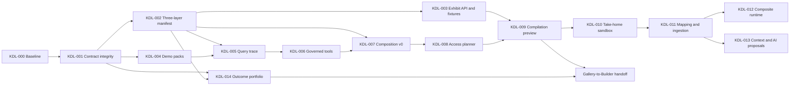

# Data Lab Core Execution Plan

**Status:** Core foundation and qualification harness implemented; first live deployment proof and product integration pending
**Last verified:** 2026-10-01
**Primary repository:** Kehrnel
**Companion design:** [Data Lab Core evolution](./data-lab-core-evolution.md)
**Portfolio design:** [Outcome catalog and reference architectures](./outcome-catalog-and-reference-architectures.md)
**UI hand-off:** [Healthcare Data Lab UI build tasks](../../HealthcareDataLab/docs/data-lab-ui-build-tasks.md)

Current checkpoint: the versioned catalogs, source-aware compiler foundation,
governed FHIR terminology query, OPT-derived openEHR semantic query, RPS Dual
projection lifecycle, and supported-strategy contracts are implemented in Core.
The current release gates report 214 foundation tests, 510 unit tests, and 548
supported-strategy tests passing, with 37 environment-dependent tests skipped.
The versioned, redacted [semantic execution qualification](./semantic-execution-qualification.md)
harness now makes the deployment gate repeatable. This is still code-level
evidence until its reference FHIR and openEHR probes pass against a named Atlas
environment; the first live run remains an explicit milestone rather than an
implied claim.

## 1. Outcome and scope lock

This plan turns the architecture into ordered Kehrnel work. The first outcome is
not a generic N-source compiler or a production operations platform. It is a
small, live proof that makes the complete proposition visible:

> Kehrnel preserves an authoritative industry document, constructs only the
> access structures justified by a workload, exposes governed interactions, and
> explains the path from domain question to MongoDB execution and evidence.

Ownership is deliberately separated: this plan's `KDL-*` work belongs to the
Kehrnel/Core stream; `HDL-CP-*` owns the thin Healthcare Data Lab control plane;
Claude's delegated work is limited to `UI-FDN-*` and `UI-*` in the companion UI
task pack. UI agents consume schemas and fixtures and do not reproduce compiler
or policy logic.

The first vertical slice is **openEHR Clinical Semantic Query**:

1. use `openehr.rps_dual`, with `openehr.rps_dual_ibm` maintained as its
   release-blocking exact-model profile, and deterministic synthetic data;
2. compose it with the SNOMED terminology capability;
3. ask a clinical question through a governed, read-only tool;
4. trace semantic expansion → standard query → compiled MQL → index → documents
   → answer evidence;
5. export a pinned, redacted evidence package for the same demo version.

The product portfolio makes openEHR the primary engineering and narrative path.
The scored readiness gate still measures terminology integration,
deterministic data, trace completeness, public-data licensing, reset safety and
setup dependencies; it determines whether a path may be shown as executed, not
which strategy receives product priority. KDL-000 records the portfolio and
readiness decisions plus intended stable strategy/demo IDs. KDL-003 publishes the final
strategy artifact reference, KDL-004 publishes the base demo artifact, and
KDL-007 publishes the composed demo version and composition lock; only then may
the Healthcare Experience Pack pin its
`primaryClinicalStrategyRef` and `primaryDemoRef`. FHIR remains a supported
secondary healthcare strategy and CDISC a supported Pharmaceutical strategy.
ContextObjects, genomics, the standalone SNOMED pack and X12 are preview-only;
the terminology gateway remains a critical shared capability independently of
the standalone SNOMED pack's delivery track.

### In the minimum lovable proof

- one authoritative contract package;
- three-layer manifest metadata and MongoDB evidence;
- deterministic demo packs and a resettable demo runtime;
- a normalized end-to-end query trace;
- an allowlisted read-only agent/MCP surface;
- one terminology-plus-clinical composition;
- a versioned outcome and reference-architecture catalog that links the live
  proof to its industry scenario without promoting editorial concepts;
- a non-deployable, pinned `demo-evidence-package/v1` export;
- stable public read APIs and golden fixtures for the UI;
- automated contract and regression tests in CI.

### Explicitly later

- live arbitrary-source discovery, credentials and production ingestion (the
  source-profile contract and read-only compilation preview are now present);
- a universal mapping language or arbitrary generated strategy code;
- the full seven-source hospital scenario;
- multi-source temporal simulation;
- production composite activation and rollback;
- multi-hospital federation;
- full production Operate;
- partner/community publication.

These remain target capabilities. They are deferred so the first proof grows
from executable strategies rather than a top-down canvas.

## 2. Engineering rules

1. **One authority per fact.** Strategy capability truth lives in Kehrnel.
   Presentation and tenant ACLs can live in HDL, but cannot override runtime
   support.
2. **No hardcoded UI knowledge.** Everything needed for a generic exhibit,
   trace, capability badge or supported choice is returned by a versioned
   contract or fixture.
3. **Authoritative first.** Try direct document access, query compilation and
   indexes before introducing a derived collection.
4. **Every access structure earns its existence.** It declares workload, SLO,
   cost, consistency, freshness, lineage, rebuild and retirement information.
5. **AI proposes; deterministic code decides.** Models cannot install Python,
   bypass schemas, or activate a release.
6. **Fail closed.** Unsupported queries, tools, mappings or policies return
   structured diagnostics before accessing data.
7. **Public means synthetic.** Public demos expose no credentials or direct
   database access and run behind bounded, read-only server APIs.
8. **Evidence before claims.** A feature is shown as executed only when the
   response carries matching runtime evidence.
9. **Backward compatibility.** Existing manifests and single-domain
   activations continue to load while v2 contracts are introduced.
10. **Separate industry presentation.** Kehrnel contracts are shared;
    Healthcare and Pharmaceutical catalogs and narratives remain distinct.

## 3. Delivery sequence and milestone boundaries



- **M0 — See + Ask:** KDL-000 through KDL-007. A public visitor can inspect
  the selected live strategy, ask one governed question, inspect its full
  trace and export a non-deployable evidence package.
- **M1 — Shape + Prove + Take it home:** KDL-008 through KDL-010. A user can
  compile a constrained Blueprint from prepackaged or tenant-discovered Source
  Profiles, prove it in a deterministic sandbox and export or launch a
  reproducible sandbox package. Novel profiles can produce an approval-gated
  candidate now; executable discovery, connectors and mappings wait for
  KDL-011.
- **Target platform — Operate and broaden:** KDL-011 through KDL-013 and
  subsequent production work. This includes governed ingestion, composite
  runtime, Context Studio-assisted discovery and typed AI proposals.
- **Portfolio track — Discover → Inspect → Build:** KDL-014 runs beside the
  delivery milestones. It must complete before the outcome gallery can open an
  exact Reference Architecture in Builder. Its editorial concepts do not
  change the execution claims of M0 or M1.

## 4. Shared definition of done

Every ticket below is complete only when:

- its public models have JSON Schema and generated OpenAPI coverage;
- success, unsupported, validation, authorization and unavailable states are
  represented explicitly;
- examples contain no credentials, PHI or customer-derived records;
- deterministic payloads have canonical serialization and digest tests;
- additive compatibility with current packs is tested;
- UI-facing responses have committed golden fixtures;
- documentation distinguishes measured, simulated and illustrative evidence;
- tests run in CI and locally through one documented command;
- no UI copy is required to compensate for missing backend truth.

## 5. Minimum stable API surface

The paths are proposed stable façades. Existing internal routes may implement
them initially, but the UI must not bind directly to private/admin shapes.

```text
GET  /api/v1/catalog/strategies
GET  /api/v1/catalog/source-categories
GET  /api/v1/catalog/source-profiles
GET  /api/v1/catalog/outcomes
GET  /api/v1/catalog/strategies/{strategyId}/versions/{version}
GET  /api/v1/demo-packs/{demoId}/versions/{version}
POST /api/v1/demo-packs/{demoId}/versions/{version}/runs
GET  /api/v1/demos/runs/{runId}
GET  /api/v1/demos/runs/{runId}/events
DELETE /api/v1/demos/runs/{runId}
POST /api/v1/queries/explain
GET  /api/v1/artifact-graphs/{graphId}/versions/{version}
GET  /api/v1/query-plans/{planId}/versions/{version}
GET  /api/v1/query-runs/{runId}
GET  /api/v1/compositions/{compositionId}/versions/{version}/agent-tools
POST /api/v1/compositions/{compositionId}/versions/{version}/agent-tools/{toolId}/invoke
POST /api/v1/compositions/{compositionId}/versions/{version}/interactions
GET  /api/v1/interactions/{interactionId}
POST /api/v1/compilations/preview
POST /api/v1/compilation-plans/{planId}/versions/{version}/proof-runs
GET  /api/v1/proof-runs/{runId}
POST /api/v1/compilation-plans/{planId}/versions/{version}/sandbox-runs
GET  /api/v1/sandbox-activations/{activationId}
GET  /api/v1/evidence-packages/{packageId}/versions/{version}
```

The current foundation exposes provisional equivalents at
`GET /v1/source-categories`, `GET /v1/source-profiles`,
`POST /v1/strategy-candidates/compile`,
`POST /v1/architecture-proposals/compile` and
`GET /v1/strategy-portfolio`. The first outcome read model is exposed at
`GET /v1/outcome-catalog`. The first exact gallery-to-Builder hand-off is
exposed at
`POST /v1/reference-architectures/{architecture_id}/instantiate`; it derives
a reviewable Blueprint, validates it with the source-aware strategy compiler,
but never saves, executes, or activates it. The stable facade may wrap these
contracts; it must not redefine their meaning in the browser. Its initial slice exposes raw
maturity, support, publication and evidence fields. Server-derived
Available/Guided/Planned summaries with contributing and blocking claims are a
subsequent KDL-014 increment.

Rules:

- every execution request contains an `artifact-ref/v1` for each strategy,
  demo, composition, pattern or Experience Pack it uses; the server rejects a
  route/body version or digest mismatch before execution;
- catalog, exhibit, demo and compile-preview responses carry contract version,
  artifact ID/version/digest and capability claims;
- public endpoints use only approved synthetic demo packs and enforce quotas;
- agent invocation is read-only in the first slice;
- no endpoint returns credentials, raw unrestricted pipelines or unredacted
  explain data;
- unsupported requests return structured diagnostics and execute no data query;
- creating a Release Candidate, connecting private sources, or activating an
  environment is authenticated and outside the public façade;
- fixed demo and ephemeral proof runs may be public under the anonymous session
  contract below; `sandbox-runs` and `sandbox-activation` are authenticated.

Execution transport is part of the contract:

- run, tool, interaction and compile-preview POSTs require `Idempotency-Key`;
  the same key and canonical request returns the same operation reference, and
  key reuse with different content is rejected;
- asynchronous progress uses Server-Sent Events with `eventId`, monotonically
  increasing `sequence`, `eventType`, `operationId`, `occurredAt`, redacted
  payload and exactly one terminal `completed`, `failed` or `cancelled` event;
- `Last-Event-ID` resumes from the next retained event, while an expired stream
  returns a typed resync response pointing to the operation resource;
- cancellation is idempotent and cannot turn a completed run back into a
  cancelled run;
- operation-creating POSTs return `202 Accepted` with `operationId`, `statusUrl`,
  `eventStreamUrl`, optional `cancelUrl` and pinned input artifact refs;
- the terminal run/interaction resource embeds or links immutable artifact
  graph, query-plan, query-run and evidence-package refs; referenced resources
  are retrievable through the GET routes above;
- responses expose standard quota and rate-limit headers plus a correlation ID;
- human-friendly aliases resolve once to an immutable versioned URL and return
  that canonical location. Public deep links never silently follow a mutable
  latest version.

Anonymous Ask does not accept identity assertions from the browser. The server
injects a fixed synthetic demo tenant, principal and `public-demonstration`
purpose, runs in an isolated resettable namespace and applies the same policy
engine as authenticated calls. Any stored public decision trace is an
ephemeral system audit/demo write, not a write-capable agent operation. Durable
decision records require authentication.

Every asynchronous resource is also bound to its initiating security context.
Authenticated runs bind to the verified tenant, workspace and principal.
Anonymous runs bind to a short-lived, high-entropy capability carried in an
HttpOnly, Secure, SameSite cookie; URLs and IDs alone grant no access. Status,
SSE resume, cancellation, query-run, interaction and evidence retrieval apply
the same binding, expiry and quota checks and return `Cache-Control: private,
no-store`. Expired anonymous state is irrecoverable and never becomes a tenant
resource implicitly.

M0 defaults to curated questions. If constrained free text is enabled, the UI
warns users not to enter personal or confidential data; the gateway applies
input classification and rejects or redacts suspected PHI before any model
call. The interaction contract pins the permitted model/provider boundary,
declares whether data leaves the execution cell, and sets zero-retention/no-
training requirements where supported. Raw public prompts are excluded from
application logs, analytics and evidence exports; only the redacted intent,
policy decision and bounded trace follow the demo retention policy.

## 6. UI-facing contract types

### Shared identity and evidence types

`artifact-ref/v1` is used wherever an artifact is read or executed:

```text
kind, id, version, digest
```

Digests have distinct meanings and must never be substituted for one another:

- `packageDigest` identifies the canonical strategy source-package contents;
  executable release identity also binds an immutable Core/runtime artifact
  and dependency locks;
- `contractDigest` identifies the exact public schema set;
- `compositionDigest` identifies a locked composition graph;
- `candidateDigest` identifies deterministic generated release content;
- HTTP `ETag` identifies one response representation and cache variant.

Evidence is capability-level, not a strategy-wide scalar:

```text
packageLifecycle: draft | experimental | preview | generally_available |
                  deprecated | retired
capabilityMaturity: not_assessed | specified | simulated | compilable |
                    pilot_validated | production_validated
supportStatus: unsupported | evaluation_only | supported | deprecated
runtimeAvailability: available | degraded | unavailable | unknown
executionState: planned | running | executed | failed | cancelled
observationKind: measured | simulated | estimated | illustrative

CapabilityClaim:
  capabilityId, capabilityMaturity, supportStatus,
  runtimeAvailability, evidenceRefs[]

ActionAvailability:
  actionId, state, reasonCode, requiredCapabilityIds[], targetRef
```

The HDL Catalog Aggregation API, not the browser, derives card summaries. A
Solution or action declares which capability IDs it requires. It is blocked if
any required claim is unavailable; otherwise its summary maturity is the
least-mature required claim. Optional claims never promote the summary. The
response includes `ActionAvailability[]` plus contributing and blocking claim
IDs so the result is explainable.

### `industry-outcome-catalog/v1`

```text
artifactRef, catalogId, version,
domains[], dataProducts[], architectureCapabilities[], visualPatterns[],
outcomes[], referenceArchitectures[], demoExperiences[]
domains[]:
  artifactRef, catalog, name, description, primarySegments[],
  industryExperienceIds[]
dataProducts[]:
  artifactRef, catalog, name, description, representationOptions[],
  inputOutcomeRefs[], outputOutcomeRefs[], owner?
architectureCapabilities[]:
  artifactRef, catalog, name, description, generatedArtifacts[],
  reuseExamples[], coreOutcomeRefs[], optionalOutcomeRefs[], reference?, scope
visualPatterns[]:
  artifactRef, catalog, name, description, screenComponents[],
  audienceInteraction, principleDemonstrated, architectInspection,
  operationExamples[]
outcomes[]:
  artifactRef, catalog, name, summary, industryExperienceIds[], domainIds[],
  scenarios[], sourceCategoryIds[], dataProductIds[], interactions[],
  capabilityMaturity, supportStatus, publicationStatus, evidenceRefs[]
scenarios[]:
  scenarioId, name, actorRoles[], trigger, goal, observableResult,
  freshnessExpectation, authorityInvariant, agentExample?, failureCase?,
  successMeasures[], interactionIds[]
referenceArchitectures[]:
  artifactRef, catalog, name, summary, architectureKind,
  outcomePatternRefs[], sourceCategoryRefs[], sourceProfileRefs[],
  dataProductIds[], capabilityIds[], consumptionKinds[], interactionIds[],
  strategyRefs[], mappingRefs[], semanticAssetRefs[], blueprintTemplateRef,
  capabilityMaturity, supportStatus, publicationStatus, evidenceRefs[]
demoExperiences[]:
  artifactRef, catalog, name, summary, outcomePatternRefs[],
  referenceArchitectureRefs[], interactionIds[], visualPatternId,
  fixturePackRefs[], runEvidenceRefs[], storyboardSteps[], failureScenario,
  capabilityMaturity, supportStatus, publicationStatus, evidenceRefs[]
```

The top-level `artifactRef` content-addresses the complete catalog and must
match `catalogId` and `version`. D/P/B/V records are typed, content-addressed
definitions rather than unchecked workbook codes. Scenario `interactionIds`
must resolve within their Outcome Pattern; Reference Architecture
`sourceCategoryRefs` are exact external artifact references. A Demo Experience
at `simulated` or higher maturity requires both fixture and completed-run
references.

An Outcome Pattern is editorial industry knowledge, a Reference Architecture is
a reusable recommendation, and a Demo Experience is a read-only story. None is
a mutable Solution Blueprint or deployable release. The full semantics and
gallery-to-Builder hand-off are defined in the
[portfolio design](./outcome-catalog-and-reference-architectures.md).
Architecture and demo back-links from an Outcome Pattern are derived by the
catalog reader rather than authored as circular content-addressed references.

### Reference Architecture instantiation contracts

```text
solution-blueprint-template-catalog/v1:
  templates[]

solution-blueprint-template/v1:
  artifactRef, catalog, industry, sources[], context[], consumptions[],
  constraints, preferredStrategyIds[], assumptions[]

reference-architecture-instantiation-request/v1:
  referenceArchitectureRef, blueprintId, revision,
  assumptionDecisions[], overrides[]

reference-architecture-instantiation-result/v1:
  status, requestDigest, derivationDigest,
  requestedBlueprintId, requestedRevision,
  referenceArchitectureRef, blueprintTemplateRef?, blueprint?,
  assumptions[], assumptionDecisions[], overrides[], requiresReview, issues[]
```

`blueprintTemplateRef` is an exact, content-addressed reference. Overrides are
a restricted JSON Patch subset over the architectural fields only. The result
is deterministic and non-executing. A Reference Architecture without a
template returns `not_instantiable` with a blocking issue; category metadata is
never expanded into guessed source, ingestion, workload, or topology choices.
`requestDigest` covers the complete canonical request, including the requested
Blueprint identity and revision, so successful and unsuccessful derivations
cannot be replayed as if they belonged to another draft. `derivationDigest`
covers the complete result except its own field.

Override values must use the canonical JSON subset. Assumption citations must
overlap the path they justify, accepted assumptions cannot be contradicted by
an override, and rejected assumptions require a relevant cited override. A
preferred-strategy override remains inside the exact strategy boundary pinned
by the Reference Architecture.

Template-to-architecture compatibility and the resulting Blueprint are checked
against the current Source Profile and strategy catalogs through the existing
compiler. This validation does not produce a Compilation Plan, persist a
Blueprint, or create an activation.

Template integrity is checked again on direct instantiation, and public cached
catalog loaders return isolated copies. Missing, corrupt, or incompatible
templates and unavailable compiler dependencies fail closed through stable
`503` responses; invalid customer decisions or overrides remain typed `422`
responses.

The bundled catalog currently contains three compiler-validated hand-offs:
`template.healthcare.openehr-cdr-starter@1.0.0`,
`template.healthcare.fhir-repository-starter@1.0.0`, and
`template.pharmaceutical.cdisc-sdr-starter@1.0.0`. They pin exact source
profiles and supported strategies while preserving visible assumptions and
their narrower maturity boundaries. OpenMRS and every other Reference
Architecture without a complete, evidence-backed template remain discoverable
and return `not_instantiable`.

### `strategy-catalog-item/v1`

```text
identity: id, name, version, digest, domain
presentation: summary, industry tags, icon reference
status: packageLifecycle, capabilityClaims[]
supports: sources, uses, interactions, demoPackRefs
domainTags, capabilityIds, compatibleContractRanges
```

### `atomic-strategy-detail/v1`

```text
identity and status
authoritativeRepresentations[]
accessStructures[]
interactionSurfaces[]
mongodbEvidence
provides[] and requires[]
constraints and unsupportedCapabilities[]
operations[]
demoPackRefs[]
```

### `demo-pack/v1`

```text
artifactRef, strategyRefs
executionLock: exactly one of atomicExecutionLockRef or compositionRef
licenseRefs[], redistributionStatus, allowedDeploymentModes[]
datasetRefs[] and checksums
activationConfig with secret references only
scriptedInteractions[]
expectedTraceAssertions[]
resetPolicy, quotas and maturity
```

`redistributionStatus` is `cleared`, `remote_provider_only`, `fictional_only`
or `blocked`. A public pack cannot activate while any included terminology or
dataset is `blocked`. Unresolved SNOMED redistribution uses a licensed remote
provider or an unmistakably fictional terminology fixture. The promoted M0
journey may claim **SNOMED** only when it uses a version-locked provider that is
legally accessible for that deployment. Fictional terminology is useful for
development but cannot satisfy M0 or carry the SNOMED label.

### `composition-lock/v1`

```text
artifactRef and compositionDigest
componentRefs[] with package and contract digests
terminologyBindings[] with provider and release refs
interactionBindings[]
policyRef and compatibilityDecisionRefs[]
```

Every executable demo pack references exactly one immutable execution lock. A
base single-strategy pack may use `atomicExecutionLockRef`; a composed pack uses
`compositionRef`. Provider selection and terminology release are therefore
reproducible rather than inferred at run time.

`atomic-execution-lock/v1` contains the strategy artifact ref, package and
contract digests, activation-config digest and data refs required to reproduce
one strategy execution.

### `artifact-graph/v1`

```text
graphRef
nodes[]: nodeId, nodeKind, artifactRef, labelKey, evidenceState,
         redactionState, traceStepRefs[]
edges[]: edgeId, edgeKind, fromNodeId, toNodeId, evidenceRefs[],
         traceStepRefs[]
```

Stable node and edge IDs drive cross-lens selection in Strategy Explorer,
Ask, Proof and Builder. The UI never reconstructs lineage from labels.

### `query-plan-trace/v1` and `query-run-trace/v1`

```text
query-plan-trace/v1 (deterministic, content-addressed):
  planRef, curatedIntentId, normalizedIntent, redactedIntent, inputDigest,
  interactionContractRef
  steps[]: stepId, parentStepIds[], stepKind, artifactRefs[], strategyRef,
           plannedInput, plannedOutput, redaction, evidenceRefs[]
  artifactGraphRef, expectedAssertions[]

query-run-trace/v1 (volatile observation envelope):
  runId, planRef, correlationId, startedAt, completedAt, executionState
  stepObservations[]: stepId, status, timings, observationKind,
                      redactedInput, redactedOutput, evidenceRefs[]
  resultSummary, citations[], metrics, policyDecision
```

The step DAG can represent terminology/ECL, FHIR Search or AQL, multiple MQL
operations, index selection and result/lineage hops. Timestamps, IDs and
measurements never participate in the deterministic plan digest.
Raw free-text input exists only in a short-lived pre-classification envelope;
it is never included in plan bytes, logs, exports or retrievable artifacts.
`inputDigest` is calculated from the normalized/redacted intent, never the raw
utterance.

### `agent-tool/v1`

```text
toolId, name, description, inputSchema, outputSchema
strategyOperationRef and interactionContractRef
readWriteRisk, idempotency, requiredScopes, allowedPurposes
sensitivity, resultLimit, timeoutMs, costBudget
citationContract, auditPolicy, capabilityClaimRef and evidenceRefs[]
```

### `agent-interaction-result/v1`

```text
interactionId, compositionRef, toolRef, queryRunTraceRef
answerState, boundedAnswer, citations[], policyDecision
confidence, reviewerState, persistenceClass
orchestratorMode, modelProvider, modelVersion, promptDigest, samplingSettings,
toolSelectionEvidence
```

M0 accepts curated intents and constrained natural language that resolves to
one eligible allowlisted tool. Agent orchestration, tool choice and event
streaming are server-owned; the UI never constructs tool calls from free text.

### `compilation-plan/v1`

Every decision contains:

```text
decisionId
requirementRefs[]
selectedCapability
physicalArtifacts[]
alternatives[] and rejectionReasons[]
rationale and evidenceRefs[]
capabilityClaims[]
estimatedCost and risks[]
simulationPlanRef when the plan is executable in the supported sandbox subset
```

### `simulation-plan/v1`

```text
artifactRef, compilationPlanRef, demoDataRefs[], scenarioParameters
executableMappingRefs[], workloadRefs[], expectedAssertions[]
requiredSandboxCapabilities[], quotas and resetPolicy
```

### Operation, export and error envelopes

```text
operation-accepted/v1: operationId, statusUrl, eventStreamUrl, cancelUrl,
                       pinnedInputRefs[]
demo-run/v1: runId, demoPackRef, executionLockRef, state, eventStreamUrl
plan-proof-run/v1: runId, compilationPlanRef, simulationPlanRef, state,
                   eventStreamUrl, ephemeral
simulation-event/v1: eventId, sequence, eventType, operationId,
                     occurredAt, redactedPayload, terminal
demo-evidence-package/v1: demoPackRef, compositionRef, queryPlanRef,
                          redactedRunEvidence, artifactGraph,
                          capabilityClaims[], generatedAt
sandbox-activation/v1: activationId, candidateRef, simulationPlanRef,
                       environmentKind(sandbox), state, evidenceRefs[]
runtime-evidence/v1: artifactRefs[], observations[], observationKind,
                     methodRefs[], collectionWindow
problem-details/v1: type, title, status, code, detail, correlationId,
                    fieldErrors[], retryability
```

`demo-evidence-package/v1` is a non-deployable M0 export. It contains no
secrets, runtime bindings or release candidate. Deployable take-home bundles
remain KDL-010 work.

### Required golden fixtures

```text
fixtures/ui/v1/catalog-strategies-healthcare-compatible.json
fixtures/ui/v1/outcome-catalog.json
fixtures/ui/v1/outcome-catalog-degraded.json
fixtures/ui/v1/strategy-openehr-rps-dual.json
fixtures/ui/v1/strategy-fhir-resource-store.json
fixtures/ui/v1/strategy-snomedct-mongodb.json
fixtures/ui/v1/strategy-cdisc-sdr.json
fixtures/ui/v1/demo-clinical-semantic-query.json
fixtures/ui/v1/composition-lock-clinical-snomed.json
fixtures/ui/v1/query-trace-primary-clinical-snomed.json
fixtures/ui/v1/query-trace-secondary-clinical-snomed-planned.json
fixtures/ui/v1/agent-tools-readonly.json
fixtures/ui/v1/agent-query-result.json
fixtures/ui/v1/agent-policy-denial.json
fixtures/ui/v1/compilation-plan-direct-access.json
fixtures/ui/v1/compilation-plan-derived-access.json
fixtures/ui/v1/simulation-events-demo.ndjson
fixtures/ui/v1/simulation-events-blueprint.ndjson
fixtures/ui/v1/runtime-evidence.json
fixtures/ui/v1/demo-evidence-package.json
fixtures/ui/v1/problem-details-*.json
```

CDISC is a release-blocking supported strategy for the separate Pharmaceutical
experience. It is not displayed in the Healthcare catalog and does not require
live CDISC execution in Healthcare M0. FHIR is the supported secondary clinical
protocol; it is not the live primary M0 journey unless its own artifact and
demo evidence are selected explicitly.

Fixture ownership is explicit:

| Contract/fixture family | Backend owner |
| --- | --- |
| Schemas, `artifact-ref`, evidence vocabulary, normalized errors | KDL-001 |
| Outcome Patterns, Reference Architectures, Demo Experiences and relationship fixtures | KDL-014 |
| Strategy catalog/detail and artifact graph | KDL-002, KDL-003 |
| Base demo pack and demo run/events | KDL-004 |
| Query plan/run trace and runtime evidence | KDL-005 |
| Atomic agent-tool schema/runtime and policy denial | KDL-006 |
| Composition lock, composition-scoped tools/interactions, composed-demo fixtures and M0 evidence export | KDL-007 |
| Compilation/simulation plans and ephemeral proof run | KDL-008, KDL-009 |
| Persistent sandbox run, candidate, approved envelope and take-home bundle | KDL-010 |

KDL-003 owns only the Kehrnel Atomic Strategy catalog and its detail fixtures.
HDL owns Industry Experience Packs, Solution Patterns, Applications,
publication/visibility and the aggregated Solutions catalog.

## 7. Implementation tickets

### KDL-000 — Baseline and safety ledger

- **Priority:** P0
- **Depends on:** none
- **Unblocks UI:** no; establishes truthful planning

**Outcome**

Record the exact current capability, test and data-safety baseline before
changing shared contracts.

**Work**

- inventory manifests, specs, operations, input/output schemas and API routes;
- classify duplicate runtime/SDK models and query implementations;
- inventory public/demo data and confirm license/provenance;
- compare the separately published SNOMED implementation with the Kehrnel pack
  for Search, Vector Search, embeddings, licenses and ownership; port compatible
  capabilities deliberately rather than merging repositories wholesale;
- identify customer-related or environment-specific files and add safe ignore or
  handling rules without opening or publishing their contents;
- record current tests and add one non-destructive aggregate test command;
- identify claims that lack executable evidence.
- score FHIR and openEHR independently against terminology integration,
  deterministic data, trace completeness, redistribution rights, reset safety
  and setup dependencies; record the product-priority decision separately from
  public-demo readiness and intended stable strategy/demo IDs for M0;
- publish a portfolio contract in which openEHR RPS Dual and its IBM profile
  are primary, FHIR and CDISC are supported, and all other current packs are
  preview-only.

**Acceptance**

- a machine-readable inventory and human summary are committed;
- every planned migration maps to an existing owner and path;
- no customer data or secret is copied into fixtures;
- the baseline test command completes without mutating non-test databases.
- primary, supported and preview tracks are recorded with evidence and an
  accountable owner; no digest is claimed before KDL-003/KDL-004 build the
  corresponding artifacts.

### KDL-001 — Contract package and manifest convergence

- **Priority:** P0
- **Depends on:** KDL-000
- **Unblocks UI:** contract client and all subsequent tasks

**Outcome**

Create one authoritative contract package and remove semantic drift between the
runtime and SDK manifest models.

**Primary seams**

- `src/kehrnel/engine/core/manifest.py`
- `src/kehrnel/strategy_sdk/manifest.py`
- `src/kehrnel/engine/core/pack_loader.py`
- `src/kehrnel/engine/core/pack_validator.py`
- `src/kehrnel/engine/core/manifest_digest.py`

**Work**

- publish versioned JSON Schemas for the KDL-001-owned foundation contracts in
  section 6 (`artifact-ref`, evidence vocabulary, normalized errors, strict
  source manifest and package file manifest), plus one registry mechanism that
  KDL-002 through KDL-010 extend with the contract families assigned to them in
  the fixture-ownership table;
- make runtime and SDK import or generate from one authoritative model;
- retain a compatibility reader for existing manifests;
- validate manifests and specs strictly with structured diagnostics;
- generate a sorted package file manifest using normalized POSIX relative
  paths; reject symlinks and special files; hash exact packaged bytes; and
  explicitly exclude VCS metadata, caches, build timestamps and temporary
  files;
- do not normalize line endings during hashing: the deterministic package
  build establishes the bytes, and a byte difference must change the digest;
- serialize the file manifest using RFC 8785 canonical JSON and derive
  `packageDigest` from it; record the immutable wheel/container digest
  separately rather than hashing an arbitrary source checkout;
- keep `packageDigest`, `contractDigest`, `compositionDigest` and HTTP `ETag`
  distinct in models and tests;
- separate package lifecycle, capability maturity, support, runtime
  availability, execution state, observation kind, visibility and publication;
- add compatibility and digest-change tests.

The current implementation defines a strategy source directory as the v1
package boundary. Every regular file below that directory,
including presentation metadata and documentation, is part of the identity;
only the enumerated VCS, cache, build and temporary artifacts are excluded.
Discovery computes this source-package identity. A future release pipeline must
stage exactly that file manifest before promotion and must record wheel and
container digests separately. Existing strategies also import Core and domain
code outside this boundary, so executable reproducibility requires a pinned
Core/runtime artifact and dependency lock in addition to `packageDigest`.
Therefore a source `packageDigest` is not a standalone executable, wheel or
container claim.

**Acceptance**

- every current strategy pack loads through the compatibility path;
- one execution-relevant byte change changes the package digest;
- the same canonical package content built twice has the same package digest,
  and symlinks or undeclared exclusions fail validation;
- presentation-only metadata behavior is explicitly defined and tested;
- malformed specs fail with a path-specific diagnostic;
- generated OpenAPI and JSON Schema examples validate in CI.

### KDL-002 — Three-layer operationalization manifest

- **Priority:** P0
- **Depends on:** KDL-001
- **Unblocks UI:** Strategy Explorer and Why MongoDB

**Outcome**

Make every strategy explain its authoritative records, minimal access fabric,
governed interactions and MongoDB evidence generically.

**Work**

- add `operationalization.authoritativeRepresentations[]`;
- add `operationalization.accessStructures[]` with `servesWorkloads`, rebuild,
  consistency, freshness, lineage, cost and retirement metadata;
- add `operationalization.interactionSurfaces[]` linked to access structures;
- add typed `provides[]`, `requires[]`, conflicts and maturity/evidence;
- add `explain.mongodb` with sample document, document-boundary rationale,
  optional qualified relational decomposition, standard query, compiled query,
  index evidence and features actually used;
- migrate openEHR RPS Dual and its IBM profile first, then FHIR Resource Store
  and CDISC SDR as the supported reference implementations; keep the standalone
  SNOMED, ContextObjects, genomics and X12 packs preview-only while allowing
  supported strategies to consume provider-neutral terminology capabilities.

**Acceptance**

- one generic serializer renders all four strategies without strategy IDs in
  its logic;
- every access structure has at least one workload reference and rebuild path;
- every “executed” MongoDB feature has evidence; missing evidence downgrades the
  claim visibly;
- canonical/authoritative payloads are not modified merely to satisfy the
  exhibit contract;
- relational comparisons are optional, assumption-labeled and fixture-tested.

### KDL-003 — Strategy exhibit API and golden fixtures

- **Priority:** P0
- **Depends on:** KDL-001, KDL-002
- **Unblocks UI:** strategy portion of UI-00, plus UI-02 and UI-03

**Outcome**

Provide stable, cacheable public read models so the interface can be developed
against fixtures and switched to live data without component changes.

**Work**

- implement catalog list/detail façades for `strategy-catalog-item/v1` and
  `atomic-strategy-detail/v1`;
- expose domains, capability IDs and compatible contract ranges for HDL to
  aggregate; exact Experience Pack compatibility and strategy refs are owned
  by the HDL pack, and Kehrnel does not own Patterns, Applications or
  presentation publication;
- publish the required golden fixtures with JSON Schema validation;
- expose supported, unavailable and degraded/error examples;
- add ETag/digest semantics and redact internal paths/secrets;
- include OpenAPI for the public façade even if legacy admin routes remain
  hidden.

**Acceptance**

- fixture and live responses validate against the same schema;
- openEHR RPS Dual and IBM are primary, FHIR is supported, and the standalone
  SNOMED pack is preview in Healthcare-compatible fixtures; only openEHR is
  marked live in the composed M0 demo, and supported CDISC remains in a
  separate Pharmaceutical fixture;
- no response requires the UI to infer maturity, support or capability;
- no credential, raw connection string or customer sample appears in fixtures;
- the selected strategy fixture publishes the immutable artifact ref consumed
  by the later demo and Experience Pack.

### KDL-004 — Deterministic demo-pack runtime

- **Priority:** P0
- **Depends on:** KDL-001
- **Unblocks UI:** live exhibits and fixed-demo replay primitives

**Outcome**

Package each demonstration as versioned data, activation, interactions and
expected evidence instead of relying on manually prepared environments.

**Work**

- implement `demo-pack/v1` loading and validation;
- content-address datasets, seeds and scripted interactions;
- require a pinned demo-pack `artifactRef` and reject route/body digest
  mismatches before provisioning;
- record license/version references, redistribution status and allowed
  deployment modes for every dataset and terminology dependency;
- provide idempotent provision, health, reset and cleanup operations;
- enforce synthetic/public-data provenance and read-only public execution;
- add bounded quotas and server-side database access—never browser credentials;
- provide `kehrnel demo up|status|run|reset <demoId>` or an equivalent stable
  command over the existing Docker/demo assets;
- make all expected results and traces deterministic or tolerance-bounded;
- emit `demo-run/v1` and ordered `simulation-event/v1` for atomic demo packs.

**Acceptance**

- a clean machine starts one demo with one documented command;
- if the promoted pack is `remote_provider_only`, local preflight states the
  required licensed provider and entitlement, obtains them through environment
  bindings and never claims offline or zero-dependency reproduction;
- reset is idempotent and never targets a non-demo namespace;
- a smoke test executes the scripted queries and validates expected evidence;
- public mode cannot write except through explicitly isolated resettable demo
  state;
- blocked redistribution prevents public activation; remote-provider-only and
  fictional-only content is labeled in every export;
- restart behavior and cleanup are tested;
- the base demo artifact ref/digest is published for KDL-007 after all
  licensing and determinism gates pass.

### KDL-005 — Normalized query and lineage trace

- **Priority:** P0
- **Depends on:** KDL-002, KDL-004
- **Unblocks UI:** Why MongoDB, Governed Ask and clickable lineage

**Outcome**

Normalize existing strategy-specific explain output into a deterministic
`query-plan-trace/v1` plus volatile `query-run-trace/v1` without removing
native detail.

**Work**

- create a trace builder and redaction policy in the core;
- adapt terminology/ECL plus the primary AQL path first; add supported FHIR and
  CDISC traces when their separate journeys have executable evidence;
- record semantic expansion, standard query, compiled MQL, chosen structures,
  index/execution evidence, result summary and provenance;
- represent execution as typed `steps[]` with stable IDs, parent references,
  per-step strategy/artifact refs, status and evidence so multi-hop queries do
  not collapse into one linear query field;
- keep the content-addressed plan free of trace IDs, correlation IDs,
  timestamps and metrics; put volatile observations in the run envelope;
- distinguish planned from executed evidence;
- enforce bounded pipeline/result disclosure by audience and role.

**Acceptance**

- the same generic trace schema represents all reference strategies;
- every result can identify the source/authoritative record and strategy
  version that produced it;
- unsupported queries fail before data access and have a traceable diagnostic;
- public traces reveal no secrets or unsafe unrestricted pipelines;
- golden trace fixtures pass snapshot and schema tests.

### KDL-006 — Governed read-only tool and MCP surface

- **Priority:** P0
- **Depends on:** KDL-001, KDL-005
- **Unblocks UI:** tool/runtime foundation; Governed Ask completes with KDL-007

**Outcome**

Turn eligible atomic strategy operations into safe domain tools independent of
any particular composition. Do not expose every operation merely because it
has an input schema.

**Work**

- add `agent-tool/v1` metadata and an explicit publication allowlist;
- require input/output schemas, read/write risk, idempotency, scopes, allowed
  purposes, sensitivity, pagination/result limits, timeout/cost budget,
  citation contract, capability claim and evidence references;
- start with read-only search, lookup, validate and explain operations;
- pass verified principal, tenant, purpose and policy context to execution;
- for public demos, inject the server-owned synthetic tenant/principal and
  `public-demonstration` purpose; reject client attempts to override them;
- emit query plan/run traces and auditable citations for every call using the
  ordered SSE transport in section 5;
- provide an MCP adapter that can coexist with MongoDB MCP infrastructure;
- add adversarial tests for unknown tools, prompt-injected parameters, limit
  bypass, cross-tenant access and unsupported operations;
- add privacy tests for pasted identifiers/PHI, provider-boundary violations,
  log/export redaction and retention expiry;
- replace the current disabled capability probe only when the tested allowlist
  is actually available.

**Acceptance**

- discovery exposes only allowlisted operations;
- no write or external action is callable in the first slice;
- public decision traces are ephemeral system audit/demo writes in the
  isolated demo namespace, never agent-exposed write tools;
- denied calls execute no data operation and return structured policy evidence;
- results are bounded, attributable and cite the governing strategy/version;
- at least one atomic tool passes deterministic correctness, policy, trace and
  limit evaluation without requiring a composition route.

### KDL-007 — Composition v0: terminology enrichment

- **Priority:** P0
- **Depends on:** KDL-002, KDL-005, KDL-006
- **Unblocks UI:** first composed Ask journey

**Outcome**

Prove real strategy composition without building the generic composite
compiler first.

**Work**

- declare SNOMED terminology/subsumption as a provided capability;
- declare the selected clinical query strategy as a consumer;
- implement minimal dependency resolution and a locked provider/version
  binding;
- emit `composition-lock/v1` with component refs/digests, terminology
  provider/release, interaction bindings, policy and deterministic digest;
- preserve standard-visible clinical semantics and the original source
  artifact/hash; operational serialization or reserved metadata may differ;
- place any expanded ancestor/search fields in a reserved, versioned,
  rebuildable access structure or envelope;
- execute one bounded clinical-meaning question end to end;
- publish the composition-scoped tool list and constrained interaction
  endpoint; M0 supports curated intents and optionally bounded natural language
  that resolves server-side to one eligible tool;
- record `orchestratorMode` (`scripted` or `live_model`), model/provider/version,
  prompt digest, sampling settings and tool-selection evidence in the volatile
  interaction/run envelope; CI and canonical demo assertions use `scripted`;
- keep live-model text and timing out of plan and composition digests;
- assemble and expose the redacted `demo-evidence-package/v1` from the locked
  composition, query plan/run, artifact graph and interaction evidence;
- persist the agent conclusion as a separate evidence-linked decision record
  only ephemerally for anonymous runs; durable persistence requires identity;
- add the second clinical protocol only through the same contract after the
  first passes.

**Acceptance**

- provider selection is deterministic and present in the trace;
- changing the terminology release changes the composition digest;
- every demo run pins and returns the same composition lock reference;
- the composed demo version/ref is published for HDL-CP-001 only after the
  licensing, policy and end-to-end execution gates pass;
- semantic expansion, clinical query, MQL, index and results share one trace;
- the integrated reference question passes deterministic correctness, trace
  and policy evaluation in scripted mode; live-model output is visibly
  non-deterministic run evidence;
- the evidence package pins every contributing artifact and contains no raw
  prompt, secret, deployment binding or licensed terminology payload;
- enrichment does not alter standard-visible fields, and the original source
  artifact/hash remains verifiable;
- stale or unavailable terminology fails or degrades according to declared
  policy, never silently.

### KDL-008 — Consumption-aware access planner

- **Priority:** P1
- **Depends on:** KDL-002, KDL-007
- **Unblocks UI:** consumption switcher and architecture comparison

**Outcome**

Given the same authoritative model and different Uses, propose the smallest
justified access fabric.

**Implementation status:** initial deterministic contract and planner slice is
available through `POST /v1/architecture-proposals/compile`. It supports typed
workload scope/query features, access-structure reuse, rejected alternatives,
projection counts, rebuild/retirement metadata and explicit implementation
gaps. Benchmark-driven ranking, encryption/topology compatibility and
retirement execution remain in this ticket.

**Work**

- define `consumption-profile/v1` workload envelopes;
- implement the direct → index → computed field → Search/vector index →
  sidecar/materialized → isolated/export escalation ladder;
- detect reuse across compatible consumers;
- calculate a projection budget and surface write/storage/freshness/migration
  implications;
- return selected and rejected alternatives with evidence and constraints;
- add deterministic workload replay and benchmark fixtures for the selected
  clinical demo; record method, dataset, environment and observation kind;
- rank with static rules first; when evidence is only estimated or missing,
  expose uncertainty and never claim the selected plan is globally optimal;
- add compatibility checks for encryption, Search, Vector Search, sharding and
  query features;
- never generate an executable strategy implementation with an LLM.

**Acceptance**

- different declared workloads deterministically produce different plans when
  required;
- a materialized projection cannot appear without a workload/SLO justification;
- removing the last consuming workload proposes retirement of its unused
  structure;
- unsupported combinations return explicit diagnostics;
- benchmark evidence is labeled measured, simulated or estimated.

### KDL-009 — Constrained compilation-preview façade

- **Priority:** P1
- **Depends on:** KDL-003, KDL-008
- **Unblocks UI:** guided Shape/Builder

**Outcome**

Compile a supported subset of a Solution Blueprint into an explainable
Compilation Plan without creating a deployable artifact.

**Work**

- accept only prepackaged source intents/profiles with already executable
  mappings in M1, plus Uses, topology assumptions and pattern refs;
- require pinned artifact refs for every referenced input and an idempotency
  key for preview creation;
- resolve Industry Experience Pack and strategy digests;
- return architecture decisions, alternatives, unsupported requirements,
  maturity and evidence;
- make public preview synthetic-only, stateless/ephemeral and quota-bound;
- require authentication for persisted private profiles or Release Candidates;
- produce an immutable Compilation Plan artifact ref and, for the supported M1
  subset, a `simulation-plan/v1`; correlation IDs remain request-scoped only.
- execute that plan through a bounded, synthetic, ephemeral proof-run endpoint
  using KDL-004 primitives; it persists no Blueprint, candidate or environment.

**Acceptance**

- identical versioned input produces the same semantic plan content;
- every decision traces to requirements and capability evidence;
- public calls cannot create releases, bindings or persistent source profiles;
- unknown capabilities remain visible and never fall through to defaults;
- fixtures cover direct-access and justified-derived-access alternatives.
- an anonymous proof run is quota-bound, resettable, pins the plan and returns
  `plan-proof-run/v1` plus ordered evidence events.

### KDL-010 — Release Candidate and take-home sandbox

- **Priority:** P1
- **Depends on:** KDL-004, KDL-009
- **Unblocks UI:** Take it home and initial Operate

**Outcome**

Turn an authenticated, validated plan into a reproducible sandbox package.

**Work**

- create `composite-strategy-candidate/v1` with a full content digest;
- approve the exact digest into an immutable approved envelope; call it signed
  only after the trust profile below is implemented;
- define canonical signed bytes, key ID, trust roots, verification endpoint,
  rotation and revocation; the initial profile is a DSSE v1 envelope over the
  candidate SHA-256 digest signed with KMS-backed ECDSA P-256/SHA-256 (`ES256`);
- package pinned strategies, config templates, demo data references, mappings,
  indexes, APIs, tests and MCP configuration without secrets;
- execute `simulation-plan/v1` through the plan-scoped sandbox-run endpoint
  using existing atomic activation/composition-v0 primitives;
- represent this limited runtime as `sandbox-activation/v1`, never as a
  production Composite Activation;
- generate local Docker/Atlas sandbox instructions and preflight;
- export an architecture/evidence document from the same artifact graph;
- expose `sandbox-activation/v1` status and read-only sandbox evidence;
- define cleanup and rollback for the sandbox scope.

**Acceptance**

- two builds from identical inputs produce byte-identical candidates;
- approval metadata does not change the candidate digest;
- verification fails closed for unknown, expired or revoked keys, and the
  envelope identifies its trust-profile version;
- a clean environment can reproduce the demo through the exported package;
- a sandbox run rejects a Compilation Plan or Simulation Plan digest mismatch
  and returns a pinned `sandbox-activation/v1` rather than a production
  Composite Activation;
- secrets are supplied only as environment bindings;
- the UI cannot offer deploy when the selected target is unsupported;
- synthetic/live and sandbox/production states are unambiguous.

### KDL-011 — Typed Mapping IR and ingestion composition

- **Priority:** P2
- **Depends on:** KDL-009, KDL-010
- **Unblocks UI:** full Mapping Studio and multi-source Healthcare proof

**Outcome**

Promote mappings from strategy-local YAML behavior into governed, portable
release assets while preserving YAML as an expert authoring view.

**Implemented foundation (2026-09-26)**

- published `mapping-definition/v1`, `mapping-catalog/v1`,
  `mapping-simulation-request/v1` and `mapping-simulation-result/v1`;
- added an integrity-checked mapping catalog with exact source-profile,
  interaction, structure, join, target-strategy and schema scope;
- added a deterministic no-write executor for safe scalar transforms;
- proved equivalent output and idempotency for batch and CDC after-images;
- emitted source document/subject routing, lineage for every target leaf and
  typed dead-letter errors;
- added the bounded simulated OpenMRS numeric-lab → openEHR mapping while
  leaving the complete production route `proposed`.
- connected profile-defined interaction selection to compilation so the
  Builder can surface exact bounded simulations without overclaiming the
  encompassing source route.

Still required for KDL-011 completion: YAML import/round-trip, repeating and
polymorphic structures, terminology lookup execution, connector replay and
join state, delete/reconciliation behavior, drift impact proposals, target
template validation and the multi-source scenario.

**Work**

- implement the Mapping IR defined in the architecture document;
- add adapters for relevant standards and existing Kehrnel YAML;
- define batch and CDC execution plans, equivalence tests and reconciliation;
- add field lineage, terminology bindings, error/dead-letter policy, drift and
  downstream impact;
- introduce connector contracts for replay, ordering, idempotency and delete
  semantics;
- build the multi-source Referral and Diagnostic Follow-up scenario.

**Acceptance**

- one mapping produces equivalent governed output through batch and supported
  streaming execution;
- every target field exposes source and transform lineage;
- source or standard version drift creates a proposal, never a silent mutation;
- YAML round-trips without semantic loss for the supported subset;
- unsupported imported constructs produce explicit diagnostics.

### KDL-012 — Composite runtime and production evidence

- **Priority:** P3
- **Depends on:** KDL-010, KDL-011
- **Unblocks UI:** production Operate

**Outcome**

Activate and operate a Composite Strategy Release as one governed unit.

**Work**

- merge atomic plans, detect namespace/resource conflicts and execute a
  dependency DAG;
- add atomic or compensated rollout and whole-release rollback;
- persist tenant/environment/solution-namespace release pointers;
- enforce cell-local policy, residency and cross-tenant isolation;
- emit durable runtime evidence, mapping drift and optimization proposals;
- route every accepted recommendation through a Blueprint revision and new
  candidate;
- define SLO, support, backup/recovery and incident ownership before production
  claims.

**Acceptance**

- partial failure never leaves a release reported healthy;
- rollback restores the complete prior release;
- an Environment hosts multiple composites only when namespace and resource
  compatibility is proven;
- tenant evidence stays local unless explicit privacy-governed opt-in exists;
- production UI is enabled only for capabilities with supported evidence.

### KDL-013 — Context discovery and governed AI proposals

- **Priority:** P3
- **Depends on:** KDL-001, KDL-009, KDL-011
- **Unblocks UI:** semantic workbench, AI-assisted Mapping Studio and approval center

**Outcome**

Integrate the useful Context Studio capabilities without making discovery or an
LLM a mandatory runtime dependency.

**Work**

- define versioned Source Profile import for observed structures, data-shape
  evidence, distributions and polymorphic families without raw sensitive data;
- define semantic-match, terminology-binding, mapping and architecture
  proposal contracts as typed diffs over pinned artifacts;
- preserve evidence, model/provider/version, confidence, assumptions,
  alternatives, evaluation results and affected artifacts for every proposal;
- validate proposals through schemas, policy, deterministic compilation and
  simulation before they can enter review;
- require explicit, scoped approval; natural-language approval is accepted
  only after displaying the exact structured diff and digest;
- publish an evaluation suite covering mapping accuracy, false matches,
  polymorphism, value-set drift, unsupported inputs and prompt injection;
- keep deterministic manual import and review paths available when AI is
  disabled.

**Acceptance**

- no model output is executable or silently mutates a Blueprint, mapping,
  terminology binding or release;
- the same approved typed diff compiles identically with AI disabled;
- every accepted or rejected proposal records evidence and reviewer scope;
- tenant observations and prompts remain isolated and are not reused across
  tenants without explicit privacy-governed opt-in;
- unsupported or low-confidence proposals remain visible without being
  presented as facts.

### KDL-014 — Outcome portfolio and reference-architecture seam

- **Priority:** P0 for the portfolio experience; parallel to the runtime M0 path
- **Depends on:** KDL-001, KDL-002
- **Links to:** KDL-003 for strategy evidence, KDL-004 for executable demo
  evidence, and KDL-009 for the Builder hand-off
- **Unblocks UI:** industry outcome gallery, architecture detail, and `Open in
  Builder`

**Outcome**

Turn the industry application matrix into a versioned, truthful discovery
catalog that leads to Kehrnel's executable assets instead of becoming a second
runtime authority.

**Work**

- publish `industry-outcome-catalog/v1` with typed `OutcomePattern`,
  `ReferenceArchitecture`, and `DemoExperience` records plus typed portfolio
  domain, Data Product, architecture capability, and visual-pattern
  definitions;
- expose the deterministic read model at `GET /v1/outcome-catalog` and generate
  its JSON Schema/OpenAPI contract;
- normalize stable IDs and explicit relationships among outcomes, scenarios,
  interaction requirements, Data Products, reference architectures, sources,
  mappings, strategies, demonstrations, and evidence;
- import the broad application matrix as editorial concepts without assigning
  generic agent, memory, terminology, or write capabilities by default;
- link reviewed lighthouse records to exact existing artifact references and
  capability claims;
- keep all initial Demo Experiences at `specified` with empty
  `fixturePackRefs` and `runEvidenceRefs`; promote a demo only after a packaged
  fixture and completed-run evidence exist;
- in the first read-model increment, expose raw maturity, support, publication,
  and evidence fields without promotion by association;
- in the next KDL-014 increment, derive Available now, Guided proposal, and
  Planned summaries from required claims and return their
  contributing/blocking evidence;
- support separate Healthcare and Pharmaceutical filters over shared backend
  definitions;
- require an immutable `solution-blueprint-template/v1` before a Reference
  Architecture can be instantiated; category-only architectures remain
  discoverable but return a structured `not_instantiable` result;
- preserve exact Reference Architecture and template references, assumptions,
  decisions, and the explicit override diff in the deterministic instantiation
  result without changing the retired source-blueprint prototype;
- validate the derived Blueprint through the source-aware strategy compiler
  without persisting a project, creating a release, or activating a runtime;
- bind every result to the full request digest, requested Blueprint identity,
  and revision; and
- fail closed on template integrity or compiler dependency failures, reject
  contradictory assumption/override combinations, and prevent preferred
  strategies from escaping the exact Reference Architecture boundary.

**Acceptance**

- catalog serialization and ordering are deterministic;
- duplicate and dangling IDs, invalid artifact references, and evidence-free
  executable claims fail validation;
- the initial seed assigns conservative record-level maturity so an executable
  target strategy does not promote a simulated or planned end-to-end journey;
- the initial nine Demo Experiences remain `specified` and
  `evaluation_only`; lower-level architecture evidence does not count as demo
  execution evidence;
- the following claim-aggregation increment proves the same rule from linked
  contributing and blocking capability claims;
- a later promoted Healthcare lighthouse resolves through every link from
  Outcome Pattern to strategy, fixture, and completed-run demo evidence;
- all remaining imported matrix rows are visibly editorial concepts unless an
  accountable review promotes them;
- filtering produces independent Healthcare and Pharmaceutical experiences
  without duplicating shared artifacts; and
- HDL can render the committed catalog read model without knowing strategy IDs
  or maturity rules in UI code; the openEHR Reference Architecture now has a
  correctly pinned Builder hand-off, while runnable demo fixtures and templates
  for additional architectures remain later KDL-014 increments.

## 8. First-slice test matrix

| Test | Expected result |
| --- | --- |
| Same demo pack provisioned twice | Same logical dataset, artifact digests and expected traces |
| Unsupported query parameter | Structured rejection; zero data-query calls |
| Clinical concept with descendants | Provider/version-locked expansion visible in trace |
| Clinical query execution | Standard query, MQL, chosen index and result lineage agree |
| Public agent tool discovery | Only approved read-only tools returned |
| Policy-denied tool call | No data access; structured policy evidence returned |
| Anonymous run URL reused from another session | Status, SSE, cancel and evidence access denied |
| Public free text containing PHI-like content | Rejected/redacted before model call; absent from logs and export |
| Changed workload latency | Access plan changes only when evidence/constraint requires it |
| Removed consumer | Unused derived structure proposed for retirement |
| Clinical record after enrichment | Standard-visible fields remain equivalent; original source hash is verifiable; enrichment is rebuildable |
| Fixture versus live API | Both validate against identical contract schemas |
| Restart/reset | Demo returns to the documented deterministic state |
| Secret scan | No fixture, trace, export or candidate contains a secret |
| Outcome catalog serialized twice | Identical ordering and canonical content |
| Catalog with a dangling relationship | Validation fails before publication |
| Simulated mapping plus executable target strategy | End-to-end journey remains Guided proposal |
| Healthcare and Pharmaceutical filters | Separate experience views; shared backend artifacts retain identical IDs |
| Reference Architecture with exact template opened in Builder | Exact architecture and template versions are pinned; assumptions, decisions, and user changes are recorded in a digest-addressed instantiation result |
| Category-only Reference Architecture opened in Builder | Structured `not_instantiable` result; no source profile, ingestion mode, workload, or topology is guessed |
| Same derivation applied to another Blueprint ID or revision | `requestDigest` and `derivationDigest` change; the result echoes and validates the requested identity |
| Override contradicts an accepted assumption or cites an unrelated one | Typed rejection before a Blueprint is returned |
| Override selects a strategy outside the Reference Architecture | Typed rejection; strategy scope cannot expand through a patch |
| Template or compiler catalog is corrupt or unavailable | Stable `503`; no partial Blueprint is returned |

## 9. UI hand-off gate

A UI ticket is ready for implementation only when Kehrnel provides:

1. the versioned schema;
2. at least one success fixture;
3. unsupported, unavailable and error fixtures;
4. stable IDs and explicit maturity/evidence;
5. redaction and public/authenticated rules;
6. a mock/live adapter contract;
7. an owning backend ticket and target version.

The UI may begin against fixtures once these seven items exist. Visual code
must not encode strategy names, infer support, construct MQL, perform semantic
resolution or duplicate compiler decisions.

## 10. Milestone acceptance

### Portfolio hand-off

The portfolio hand-off is complete when a visitor can enter through the
Healthcare or Pharmaceutical experience, choose an Outcome Pattern, inspect
its scenario and honest maturity, view the linked Reference Architecture and
Demo Experience, and open the exact architecture version as a new Solution
Blueprint. Concept-only outcomes remain useful and visible but cannot imply a
simulation, connector, strategy, or runtime claim that Core cannot evidence.

### M0 — See + Ask

M0 is complete when a new visitor can open the Healthcare experience, inspect
the live openEHR RPS Dual strategy, ask one terminology-aware question, watch
the complete governed trace, and export a pinned, redacted, non-deployable
evidence package—all without supplying a database connection. An engineer can
start the same immutable demo pack locally when its declared terminology
entitlement/provider prerequisites are satisfied. A promoted SNOMED claim
requires a legally accessible version-locked provider. FHIR is clearly shown
as a supported secondary path, not as the live M0 journey without its own
pinned execution evidence.

### M1 — Shape + Prove + Take it home

M1 is complete when a user can change a supported prepackaged Source with an
existing executable mapping, Use or workload, inspect the deterministic
Compilation Plan and rejected alternatives, prove it with a locked simulation,
and—after sign-in where persistence is required—run or export the same version
as a reproducible local or Atlas sandbox. Novel schemas and generated mappings
remain target-platform work under KDL-011.

### Target platform

Production acceptance requires typed ingestion/mapping, composite activation,
isolation, rollback, durable evidence and supported Operate contracts. These
are not implied by M0 or M1.

M0 is the smallest credible demonstration of the full vision: document-model
fidelity, efficient consumption, semantic composition, governed agents and
MongoDB-native execution. M1 establishes the path from public proof to a
customer-shaped deployment.
