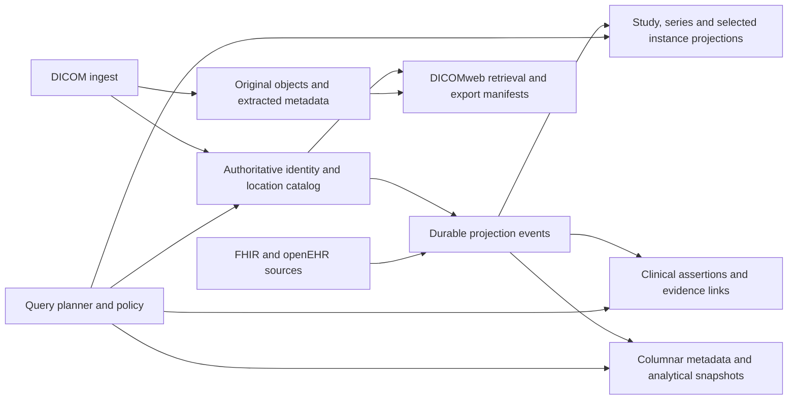

# Proposed DICOM and multimodal discovery strategy at 15 billion instances

Date: 2026-10-15. Status: architecture proposal, not an implemented capacity claim.

## Recommendation

Build a native imaging archive with a compact distributed catalog, several versioned search projections at their natural data grain, and a columnar metadata layer for exploratory queries. Connect imaging to FHIR and openEHR through explicitly defined clinical facts and evidence relationships. Preserve each standard's native content and semantics.

Search projections are central to this design. Their purpose is to make selective discovery inexpensive without making clinical corrections, new tags, or projection changes require rewriting the entire archive. A single document or search index containing everything for every image would undermine that goal.

The initial assumption is a balanced clinical retrieval and research workload. “15 billion instances” means DICOM SOP instances for the calculations below. Frames, pathology tiles, alternative representations, retained revisions, clinical facts, and derived assets have separate cardinalities. If the actual requirement counts frames, the capacity model changes substantially.

The service promise should distinguish three operations:

1. Routed retrieval by identity and interactive discovery over declared indexed predicates.
2. Complete access to preserved metadata, including uncommon and private attributes, through bounded scans or asynchronous jobs.
3. Snapshot-based cohort export and analysis at population scale.

Universal subsecond execution of every possible query across 15 billion objects is not a defensible requirement. Complete access and a growing set of fast access paths are achievable architectural goals; measured workloads must determine latency guarantees.

## 1. Lessons from openEHR, FHIR, and DICOM

| Model | Strength to retain | Physical-design implication |
|---|---|---|
| openEHR | Stable reference model, archetypes/templates, typed values, occurrence-aware paths, clinical context, versioned records | Preserve compositions and semantic bindings; derive compact facts for cohort execution instead of copying composition structure into imaging records |
| FHIR | Interoperable resources, references, profiles, terminology bindings, defined search parameters | Preserve clinical resources; materialize typed search fields; expose imaging summaries and retrieval references through appropriate resources |
| DICOM | Imaging object identity, acquisition metadata, SOP classes, pixel/bulk data, spatial information, structured reports and image references | Preserve native objects; support study, series, instance and specialized sub-instance access; parse according to SOP class rather than assuming every object is a slice |

These standards are complementary. None specifies the distributed database, shard topology, or cost model needed for this archive.

Kehrnel already contains two useful implementation patterns:

- `openehr.rps_dual`: a reconstructable primary representation and optional slim search sidecar, with correlation and readiness contracts.
- `fhir.resource_store`: canonical resources with mandatory deterministic `_search` and `_compartments`, plus separate operational projection versions.

Reuse the separation of source meaning and access optimization, typed values, lineage, and targeted reprojection. Do not transplant either physical layout wholesale into DICOM.

FHIR `ImagingStudy` describes significant DICOM information and how to retrieve it; its specification explicitly says the instances themselves are not stored in that resource. Use `DiagnosticReport`, `Observation`, `Condition`, `ServiceRequest`, `Specimen`, and `Endpoint` for their appropriate clinical roles. FHIR R5 `ImagingSelection` can identify instances, frames, segments, SR content items, and regions within one study and series. A cross-series or PET/CT selection requires multiple selections connected by the clinical observation. For partners on another FHIR release, use their supported profiles and equivalent representations; this proposal does not require a release migration.

Generate bounded ImagingStudy representations, with counts, summaries and endpoints, rather than embedding every instance into a giant resource. Declare when the resource describes only a subset; the standard permits this. Preserve openEHR imaging assessments and references through governed archetypes/templates rather than converting every image into a composition.

DICOMweb is already broader than study browsing: the current native Studies Service includes searches across all series and all instances. Retain QIDO-RS, WADO-RS, and STOW-RS interoperability, with DIMSE gateways where required. Add a separate clinical cohort/search API for cross-domain Boolean, temporal, evidence and analytical semantics that exceed the standard search contract. Advertise exact supported matching behavior in a conformance statement.

## 2. Data architecture



### Original content and representations

Store original DICOM objects in distributed object storage, with checksums, custody/source provenance, transfer syntax, object size, lifecycle state and durable locators. Preserve source bytes so parser changes, private-tag interpretation and clinical investigations can return to the original evidence.

Separate logical SOP identity from stored representation identity. One SOP instance can have several transfer-syntax representations, replicated locations or custody copies. Transcoding is not necessarily a new logical instance. A producer sending conflicting content under the same UID must trigger an explicit collision/reconciliation policy; it must not silently overwrite evidence. Distinguish acceptable alternative encodings from contradictory datasets.

Object keys should use stable storage identity and hash prefixes, not patient names, diagnoses or other mutable metadata. Patient merges should change identity links, not move petabytes. Deduplication should respect custody and permitted security boundaries.

Maintain extracted DICOM metadata independently of pixels, with all available standard and private attributes and large metadata sidecars where needed. DICOM JSON is useful for interoperability, but it is not a promise of byte-identical reconstruction: preserve the source object, original values where significant, and bulk-data references. Do not duplicate base64 pixel content into the catalog or search index.

Very large functional-group metadata, frame maps and membership lists belong in chunked manifests or sidecars, not unbounded database document arrays. Tiny-object packing may be economical for some subsets, but it complicates individual deletion, retention and range reads; adopt it only after measuring the actual object distribution.

### Compact operational catalog

Keep separately bounded records for studies, series, logical instances and stored representations. A study document is not the container for all its instance documents.

An illustrative instance record is:

```json
{
  "tenant_id": "tenant-1",
  "instance_id": "internal-stable-id",
  "study_id": "internal-study-id",
  "series_id": "internal-series-id",
  "study_uid": "1.2.3",
  "series_uid": "1.2.3.4",
  "sop_instance_uid": "1.2.3.4.5",
  "sop_class_uid": "class-uid",
  "partition_id": 412,
  "number_of_frames": 1,
  "metadata_ref": "metadata-locator",
  "representation_manifest_ref": "representation-manifest-locator",
  "catalog_revision": 17,
  "availability": "online"
}
```

The logical contract is more important than this JSON encoding. Use compact internal keys and dictionaries where measured byte savings justify them; retain standards identifiers at the API boundary and in authoritative identity records. A companion representation record contains checksum, transfer syntax, location, byte length and revision.

Maintain direct SOP UID routing and study/series membership manifests. Do not use object-store listing or broadcast every exact lookup to all database shards. Patient history needs a separate subject-to-study index because study partitioning alone does not optimize it.

### Clinical assertions and relationships

Keep source FHIR/openEHR/report records and a derived common assertion model used specifically for discovery. An assertion should carry:

- Namespaced subject identity and merge history references.
- Original code system, code and version; independently versioned normalized mappings.
- Role: diagnosis, indication, imaging finding, differential, family history, response or another defined clinical role.
- Present/absent/uncertain state, verification, activity status and experiencer.
- Clinical effective interval and separately recorded/source revision time.
- Anatomy, laterality, lesion identity and measurements where applicable.
- Exact evidence pointer, extraction method, mapping/model version, confidence and review state.

Relationships are separately typed and can target patient, episode, order, specimen, study, series, instance, frame, segment, SR content item or ROI. Examples include `indication-for`, `evidence-for`, `measurement-of`, `derived-from`, `registered-to`, and `follow-up-of`.

A patient having lung cancer, an examination ordered to investigate suspected lung cancer, and an image showing evidence of lung cancer are different predicates. Patient-ID joins alone cannot establish all three relationships.

Never copy a patient's entire condition list into every image record. Store assertions once, explicit evidence/indication links at their real scope, and selected study-level summaries when a particular workload warrants them. Corrections then affect the assertion and bounded links, not all historical images.

## 3. Projection families

| Projection | Grain | Primary access |
|---|---|---|
| Identity/location directory | Every logical instance and stored representation | Exact lookup, availability and retrieval |
| Study discovery | Study | Patient timeline, date, accession/order, modality sets, anatomy facets, study status and counts |
| Series/acquisition discovery | Series or defined acquisition group | Modality, SOP class, protocol, device, anatomy/laterality, acquisition properties and volume eligibility |
| Selected instance metadata | Applicable instance subsets | Values that vary per instance and justify an important filter |
| Clinical assertions | Assertion/finding/measurement | Condition, phenotype, status, time and evidence |
| Evidence relationships | Typed link | Clinical-to-imaging association and derivation |
| Specialized sub-instance | Selected frames, segments, regions, SR nodes | Exact findings, measurements, temporal phases, pathology tiles and annotations |
| Report search | Report/section | Lexical discovery and provenance-bearing extracted findings |
| Analytical metadata | Partitioned columnar records | Uncommon tags, large aggregates, new predicates, backfills and exports |

Most discovery should finish at study, series or finding grain. Expand to instances only after selection or when the user explicitly requests instance results.

Projection is a derived data model; an index is the physical access structure over that model. A projection can use ordinary database indexes, an inverted index, columnar scans, or precomputed postings. Search projections do not require putting every projection in a full-text search engine.

Use exact/range indexes for identifiers and typed attributes, inverted indexes for report text and selected facets, and columnar execution for broad scans and aggregation. Consider cached cohort membership or bitmap postings for frequent, well-defined population predicates. Keep result IDs partitioned and use appropriate 64-bit or partition-local representations: a single 32-bit ordinal cannot identify 15 billion instances.

### Metadata typing and sequence correlation

Preserve tag, VR, multiplicity, original lexical value where needed, charset, sequence order/occurrence and private-creator namespace. Normalize query forms without replacing the evidence:

- Numeric DS/IS values need numeric access and precision-preserving source values.
- DA/TM/DT values need original precision and timezone/offset evidence; an absent offset must not become an invented UTC timestamp.
- PN values need component-aware matching and original forms.
- Coded sequences need coding scheme, code and version, plus original display text.
- Private attributes need their private creator and vendor/parser interpretation version.
- Missing, empty, invalid, inapplicable and documented-negative values must remain distinguishable.

For selected arbitrary-tag indexing, use a stable path dictionary and typed values rather than dynamically making each observed nested path a new search-engine field. A selected posting might contain:

```json
{
  "entity_id": "instance-or-finding-id",
  "path_id": 412,
  "sequence_scope_id": "measurement-item-7",
  "ancestor_scope_id": "finding-2",
  "value_ordinal": 0,
  "vr": "DS",
  "numeric_value": 8.0,
  "original_value": "8.0",
  "source_revision": 17,
  "projection_generation": "g4"
}
```

This is not a recommendation for a universally indexed row for every attribute of every instance. Such an EAV expansion can produce trillions of rows and enormous write amplification. Preserve complete metadata in bounded nested/columnar forms and create typed postings for justified query subsets.

Predicates on concept, value and unit must bind to the same measurement item and appropriate ancestor finding. A report containing a 3 mm nodule and an unrelated 9 mm measurement must not match “nodule size >= 8 mm”. Equivalent correlation is needed for repeated FHIR components, openEHR nodes and DICOM sequences.

Promote a value from instance to series only when invariance is established, or preserve an explicit value set, conflicts and exceptions. A summary such as `minimum_slice_thickness <= 1` proves an existential predicate, not that every instance is thin-slice. Summary projections may generate candidates; exact predicates must be verified at their proper scope.

### Flexibility without uncontrolled indexing

Maintain a metadata/projection catalog that states what can be retrieved, scanned or searched interactively. Profile tag occurrence and cardinality by modality, SOP class and vendor. New attributes remain available from preserved metadata and can be queried through analytical scans before an interactive projection exists.

Promote a new access path through a controlled lifecycle: define semantics and applicability, measure selectivity and projected bytes, backfill the affected subsets, verify coverage, publish the supported query contract, then monitor usage. An automatic index advisor can propose changes, but should operate under storage and write-cost budgets and hysteresis.

Do not silently search a partial projection and interpret no match as no data. Offer a complete slower plan, an asynchronous scan, or an explicitly partial result when the caller requests that behavior.

## 4. Multimodality needs several structures

Keep patient -> study -> series -> instance for DICOM interoperability, with orthogonal clinical, spatial and specimen relationships.

| Family | Additional model |
|---|---|
| CT/MR/PET | Acquisition/volume manifests, geometry, orientation, temporal phase, echo/diffusion dimensions and registrations |
| Enhanced multiframe/US/video | Shared and per-frame functional groups, frame/time dimensions and codec-aware retrieval maps |
| Digital pathology | Specimen/block/slide, optical path, focal plane, pyramid level, tile coordinates and physical scale |
| SR/SEG/parametric maps | Content items, observation/tracking IDs, segment labels, measurements, units, source-image and frame references |
| Radiotherapy | Plan, structure set, dose and treatment relationships; frame-of-reference and registration lineage |
| Waveforms and other content | Channel/time metadata, non-image SOP classes and referenced clinical events |
| Non-DICOM assets | Native content format, MIME/type schema and clinical links; appropriate FHIR DocumentReference/other supported representations |

A series is not universally a 3D volume. Build validated acquisition/volume manifests that group compatible geometry and dimensions. Maintain frame-of-reference UIDs and explicit transforms when linking spatial data; cross-modal correspondence must have registration evidence.

Frame counts can dwarf SOP counts. Store frame maps compactly, and index individual frame attributes or tiles only for workloads that need them. Compressed fragments do not universally correspond one-to-one to independently decodable frames; byte-range retrieval alone is insufficient. Keep codec-aware retrieval logic and preserved original content.

Use embeddings for selected reports, representative acquisitions, findings, lesions or image subsets. Record source, model and preprocessing versions. Similarity can discover candidate evidence; it does not independently establish a diagnosis or reproducible clinical eligibility. Universal image/frame embedding is a separate capacity decision.

## 5. Query strategy

Define result grain explicitly: patient, episode, study, series, logical instance, representation, finding, frame or export manifest. Counts and deduplication must use that grain.

The planner binds both terminology and structural semantics, checks policy and projection coverage, estimates selectivity and fanout, and selects an access plan. It should support:

1. **Exact identity:** UID directory -> routed catalog -> authorized retrieval.
2. **Patient timeline:** resolved subject aliases -> subject-to-study index -> summaries -> chosen series/instances.
3. **Acquisition discovery:** series/acquisition projections -> selected instance verification if needed.
4. **Clinical cohort:** clinical assertions -> patient/time or explicit evidence relationships -> imaging metadata intersection.
5. **Uncommon metadata:** pruned columnar scan with typed nested extraction -> streamed IDs or a snapshot export.
6. **Similarity:** permitted candidate index -> exact metadata/clinical filters -> evidence-bearing results.

For example, “chest CT within 90 days after a confirmed lung cancer diagnosis, before treatment, with thin-slice reconstructions” should:

1. Resolve a versioned condition value set and confirmed diagnosis assertions.
2. Match diagnosis and treatment intervals for the same permitted subject/episode according to the explicit temporal rule.
3. Select associated studies and eligible CT acquisition series.
4. Apply the defined thin-slice criterion at the series/instance grain; verify exceptions when required.
5. Return studies or series, evidence references and counts; expand instances only if requested.

The planner may begin with selective CT metadata and semijoin to diagnoses if that is cheaper. Avoid giant client-side `$in` lists: use distributed semijoins, partitioned temporary ID sets or compact postings with filtering pushed to the owning partitions.

Condition semantics require explicit rules for active-at-acquisition, onset-before, within-N-days, before-treatment, recurrence and negation. “No diagnosis recorded” is different from “diagnosis explicitly absent”. For negative cohort predicates, define the eligible population and observation window. Preserve original terminology codes; mappings between SNOMED, ICD and local codes need declared equivalence/broader/narrower relationships and versions.

Use cursor/keyset or partitioned continuation for large query APIs. Provide exact counts where affordable or as a separate job, and label approximate counts. Execute batch/export workloads on isolated resources so they cannot consume clinical retrieval capacity. Export immutable manifests with data and policy snapshots, source revisions, query definition, terminology versions and generation receipts.

## 6. Physical partitioning and deployment

Recommended starting stack in Kehrnel's current ecosystem:

- Distributed object storage for original/derived bulk content and large manifests.
- Sharded MongoDB for the compact operational catalog, bounded clinical facts/relationships and operational projections.
- Atlas Search or another inverted-index engine over governed study/series/report/finding fields where those access paths are justified.
- Parquet with Iceberg or an equivalent transactional columnar table format for broad metadata/clinical analysis and reproducible snapshots; a distributed SQL engine and, if measured latency demands it, a serving columnar engine.
- Durable replayable events/CDC with independently scalable projection workers.

This is a concrete starting hypothesis, not a claim that one vendor configuration handles 15 billion records. Benchmark MongoDB catalog/index costs, routed access and the actual search engine's query behavior before final selection. A distributed KV store can be evaluated for the smallest identity directory if its economics are materially better; it need not be introduced by default.

Partition by permitted region/tenant boundary first, then use stable virtual hash partitions for operational records. Study-hash routing is a reasonable starting point for study/series/instance locality. Record explicit sub-buckets for exceptionally large studies. The routing layer maps virtual partitions to physical shards/cells and allows incremental rebalancing.

Maintain different access structures for different distributions:

- SOP identity directory: partitioned for UID lookup.
- Operational instance catalog: study locality and explicit large-study handling.
- Subject timeline: subject-oriented postings to study IDs.
- Population/search projections: independent partitions aligned with their query and service constraints.
- Analytical tables: coarse region/time partitions and suitable bucket/sort layouts, with compaction and late-arrival handling.

Do not partition solely by study date: historical UID retrieval still needs routing, and active dates can hotspot. Do not use condition or modality as the sole shard key: skew and cross-condition queries make them unsuitable. Do not create one analytical file/partition per patient or study.

If MongoDB is selected, validate shard-key and uniqueness constraints together. A global-looking unique UID index on an incompatible shard key cannot be assumed to enforce identity. Use the routed identity reservation/directory contract and suitable shard-local uniqueness. Measure cross-shard transactions and avoid using them as the routine per-image ingest path.

Several independently operable regional/archive cells may be appropriate at this scale. Global discovery then federates their declared snapshots and coverage. Cell topology must follow residency, failure-domain and operational requirements rather than a fixed invented shard count.

## 7. Projection lifecycle and consistency

Object storage and the database do not share a transaction. Use a recoverable state machine:

1. Stream/validate the incoming object, checksum it, and persist it durably.
2. Reserve the namespaced logical UID idempotently in its routed identity partition, with a fencing token and an explicit duplicate/representation/conflict decision. Reserve additional hierarchy identities where their contract requires it.
3. Commit catalog state and a projection outbox record atomically within the supported catalog transaction boundary, recording the reservation token and intended route.
4. Publish the UID directory's recoverable READY transition only after the catalog/content commit is durable and usable. The route must identify the committed catalog revision; readers must not mistake a pending reservation for an available instance.
5. Acknowledge according to the declared ingest/storage-commitment semantics, with direct routing usable for accepted available content.
6. Replay events into projections; retry and reconcile incomplete transitions, abandoned reservations and orphaned objects.

The directory and study-local catalog may use different physical partitions. This is a recoverable protocol rather than a claim of one routine cross-shard transaction. Reconcile concurrent arrivals, crash recovery and expired reservations using fencing/revision checks so an old worker cannot publish or release a newer reservation. Never advertise a successful route to uncommitted or unavailable catalog content.

Keep the minimum retrieval catalog immediately available after accepted commit. Derived discovery can be asynchronous under a stated freshness bound. Clinical resources can retain their existing synchronous projection invariants; this proposal does not weaken the FHIR storage contract.

Projectors must handle duplicates, ordering, source revisions, deletions and amendments idempotently. Record source digest/revision, parser, mapping, terminology, projector and index-definition versions. A durable history or retained snapshot plus replay log is needed for backfill beyond change-stream retention.

Each projection family publishes partition-scoped manifests with applicability, supported predicates, coverage/exclusions, source and applied watermarks, lag, active generation and verified live queryability. Coverage should distinguish source completeness from indexing completeness. Successful exact verification of candidates cannot recover matches missing from an incomplete index.

For changes:

1. Identify affected families, modalities/SOP classes/vendors and partitions.
2. Pin source snapshots and event positions.
3. Backfill a new generation in resumable bounded ranges.
4. Replay subsequent changes and tombstones with revision comparisons.
5. Verify keyed source/target reconciliation, conflicts, actual index definitions and queryability; row counts alone do not prove equality.
6. Publish a new routing/manifest generation atomically at the appropriate boundary and preserve rollback capacity.
7. Retire older generations under the retention policy.

Queries pin a compatible generation/watermark vector. Independent stores do not automatically yield one transactionally consistent global clinical snapshot: provide a declared bounded-staleness contract for interactive discovery and coordinated snapshots for reproducible cohorts. Return applicable coverage and freshness evidence.

Do not run full-corpus readiness scans before every query or invalidate all queries whenever any image is ingested. Kehrnel's existing whole-slice readiness checks and mutation fences are useful correctness patterns for bounded datasets, but must become manifest-based, partition-scoped checks for this archive.

## 8. Capacity constraints

The following are decimal logical bytes before compression, index/engine overhead, replication/erasure coding, history, backups and rebuild generations.

| Assumption | At 15 billion SOP instances |
|---|---:|
| Extra 1 KB per instance | 15 TB |
| Extra 2 KB per instance | 30 TB |
| 10 KB metadata per instance | 150 TB |
| Mean 1 MB original object | 15 PB |
| Mean 5 MB original object | 75 PB |
| 768-dimensional float32 vector per instance | 46.08 TB of raw vectors |

If the measured mean is 300 instances/study, there are 50 million studies. At 10 KB per study projection, that is 500 GB of logical projection data. This assumption is illustrative; pathology, video and enhanced imaging can change the distribution dramatically.

A full 15-billion-row backfill has these arithmetic lower bounds:

| Hypothetical sustained processing rate | Processing time |
|---|---:|
| 10,000 rows/s | 17.4 days |
| 100,000 rows/s | 41.7 hours |
| 1,000,000 rows/s | 4.17 hours |

These are not achievable-throughput claims. At 100,000 rows/s, 10 KB output rows alone require 1 GB/s before indexing or replication. Parsing, metadata reads, network, merges, catch-up events and verification add cost.

Size each store using measured record counts by grain multiplied by measured physical bytes, plus indexes, protection overhead, retained snapshots, dual-generation rebuild headroom and operating reserve. Add request counts, egress, inventories, repairs, rebalancing and restore bandwidth to the cost model. A plan that fits steady-state bytes but cannot rebuild or recover is incomplete.

## 9. Access policy and provenance

Apply authorization to discovery, counts, facets, retrieval and exports. Clinical facts, metadata, reports and embeddings can all reveal sensitive information. Filter permitted scope before materializing results and enforce policy again when retrieving content. Export manifests should reference policy/consent snapshots and be revalidated when consumed if required.

Keep namespaced patient identifiers and issuer-scoped accession/order identifiers. Resolve merges and splits through a controlled identity service; unresolved identity must remain visible in coverage, not become a guessed patient link. Research identities can use a permitted pseudonym mapping without rewriting source DICOM.

Deletion and corrections propagate through original content policy, metadata, projections, caches, vectors and analytical snapshots. Storage retention and required legal holds must be reconciled explicitly with deletion semantics. Access revocation should take effect through policy enforcement even while projection removal catches up. De-identification for research must include private tags and burned-in annotations where relevant.

## 10. Delivery and evidence

### First increment: prove the model and ingest correctness

Inventory instance/frame/representation counts, modality mix, object and metadata sizes, extreme studies, condition prevalence and workload QPS/concurrency. Establish the top query contracts and target result grains. Implement durable ingest, direct identity lookup, bounded catalog/manifests, core study/series discovery and an initial complete analytical metadata subset.

Use a representative development corpus, including SR, SEG, enhanced images, US/video, pathology, RT and malformed/conflicting producers. Validate source fidelity, typed predicates, sequence correlation, availability and retry behavior.

### Second increment: prove clinical discovery

Add governed clinical assertion extraction, identity linkage, condition/indication/evidence distinctions, pinned terminology and temporal joins. Implement FHIR/openEHR adapters and standard imaging exposure. Validate cohort precision/recall against adjudicated cases and adversarial repeated-node/negative-evidence examples.

### Third increment: prove distribution and projection operations

Introduce partition-scoped generations, resumable backfill, event catch-up, live coverage, routing, large-study sub-buckets and resource isolation. Test concurrent ingestion, broad queries, deletion, identity merges, shard loss, rebalancing and interrupted rebuilds. Preserve exact result-grain and snapshot semantics across partitions.

### Fourth increment: qualify production capacity

Test increasing dataset sizes with realistic distributions and extrapolate only measured per-partition behavior plus measured cross-partition overhead. Qualify full target metadata/index cardinalities and operating procedures before committing to a 15-billion-instance SLA. Representative payload tests and object-count/storage-plane qualification can be separate, but both need evidence.

Report p50/p95/p99 end-to-end latency, concurrent throughput, bytes read, fanout, exact result correctness, projection lag/coverage, cold/warm behavior, export rates, rebuild/catch-up duration, failure recovery and cost per workload. Include growth and rebuild headroom. Historical billion-document benchmarks from a different schema cannot establish this archive's SLA.

## 11. Kehrnel implementation direction

Add a distinct proposed `dicom.catalog_projections` strategy rather than changing existing FHIR or openEHR physical layouts. Define native DICOM bindings and a composed imaging-clinical discovery contract under the existing semantic execution framework.

The strategy should own:

- Object/catalog/representation identity and ingest state contracts.
- Native metadata and SOP-specific extraction contracts.
- Study/series/instance and specialized projection manifests.
- Evidence-link and clinical-discovery schemas with explicit grain and correlation.
- DICOMweb query/retrieval bindings and a broader cohort/export binding.
- Byte/cardinality/write-amplification budgets and operational readiness.

Reuse the existing deterministic access planning, terminology receipts, per-resource projection digests and live index-readiness ideas. Extend readiness to projection family/SOP class/partition, add executable distributed semijoins and coordinated cohort snapshots, and strengthen index budgets beyond index count.

Current limits should be explicit: the existing native clinical compilers support bounded conjunctions; the FHIR Condition cohort surface counts matching resources rather than a general deduplicated patient cohort; current projection mechanisms do not prove atomic complete-generation publication at this new scale. This proposal requires additional capabilities, not merely a larger database deployment.

## References

Public standards verified while preparing this proposal:

- [DICOM PS3.18 Studies Search](https://dicom.nema.org/medical/dicom/current/output/chtml/part18/sect_10.6.html): search resources, required matching attributes and private tags.
- [DICOM JSON object structure](https://dicom.nema.org/medical/dicom/current/output/chtml/part18/sect_F.2.2.html): VR, value multiplicity, sequences, bulk references and charset.
- [DICOM JSON value types](https://dicom.nema.org/medical/dicom/current/output/chtml/part18/sect_F.2.3.html): precision-preserving numeric strings and native date semantics.
- [FHIR R5 ImagingStudy](https://hl7.org/fhir/R5/imagingstudy.html): imaging summaries, subsets and DICOM retrieval boundaries.
- [FHIR R5 ImagingSelection](https://hl7.org/fhir/R5/imagingselection.html): precise image/frame/segment/SR/region linkage and single-series scope.
- [openEHR Architecture Overview](https://specifications.openehr.org/releases/BASE/latest/architecture_overview.html): multi-level models, versioning, archetypes/templates and occurrence-aware paths.

Repository foundations:

- [Semantic authority and execution plans](semantic-authority-and-execution-plans.md).
- [Clinical intent resolution](clinical-intent-resolution-architecture.md).
- [FHIR stored-document ADR](adr-fhir-stored-document.md).
- [RPS Dual data model](website/docs/strategies/openehr/rps-dual/data-model.md).
- [RPS Dual query readiness and rebuild limits](website/docs/strategies/openehr/rps-dual/query-translation.md).
- [Deterministic access planner](../src/kehrnel/engine/core/access_planner.py).
- [FHIR projection version contract](../src/kehrnel/engine/strategies/fhir/resource_store/scripts/document_contract.py).
- [FHIR index manifest](../src/kehrnel/engine/strategies/fhir/resource_store/scripts/index_manifest.py).
