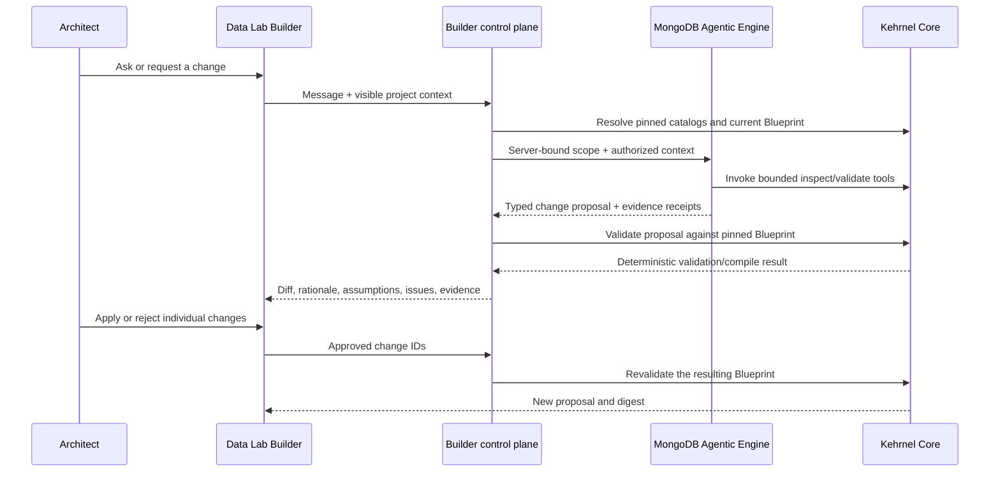

# Modeler Agent architecture

**Status:** implementation baseline
**Date:** 2026-09-27
**Runtime decision:** MongoDB Agentic Engine
**Related:** [Outcome catalog and reference architectures](./outcome-catalog-and-reference-architectures.md), [Data Lab Core execution plan](./data-lab-core-execution-plan.md), and [Builder narrative](./builder-narrative-ui-handoff.md)

## 1. Decision

The Builder's conversational assistant is the **Modeler Agent**. It runs as a
MongoDB Agentic Engine workspace and uses Kehrnel as its deterministic source
of architectural truth.

The Modeler Agent is not a second compiler, a second catalog, or a chat wrapper
around MongoDB documentation. Its purpose is to help a person understand a
project, explore alternatives, and prepare small, typed changes for review.
Kehrnel validates and compiles every accepted change. The user remains the
authority for assumptions and approval; the control plane remains the authority
for persistence and activation.

The existing investigator in
`pharma-research-non-clinical-magenta/services/agent` is the reference
implementation pattern:

- one standard Agentic Engine workspace declared by `agent.yaml`;
- a LangGraph entrypoint hosted by the Agentic Engine, not by a second custom
  API server;
- server-bound scope that the model cannot redirect;
- registered, bounded tools with a declared tool registry;
- MongoDB-backed conversational checkpoints;
- deterministic retrieval before model synthesis;
- typed receipts returned to the application; and
- deterministic fallback when the agent is unavailable.

## 2. Authority boundary

The following ownership rules are non-negotiable:

| Concern | Authority |
| --- | --- |
| Industry outcomes and Reference Architectures | Kehrnel content-addressed catalogs |
| Customer design intent | Solution Blueprint |
| Source, mapping, strategy, and capability truth | Kehrnel catalogs and runtime evidence |
| Reasoning, explanation, and candidate alternatives | Modeler Agent |
| Proposal validation and architecture compilation | Kehrnel deterministic Core |
| Human assumptions and approvals | Builder user and approval record |
| Project persistence, tenant access, and activation | Data Lab control plane |
| Conversational continuity | Agentic Engine checkpoint memory |

Agent memory is never architecture truth. A remembered preference may guide a
question, but it cannot replace a Blueprint field, an artifact reference, an
approval record, a source observation, or a compiler result.

## 3. One assistant, specialized modelers

The product exposes one consistent Modeler Agent surface. Specialization is
implemented inside one Agentic Engine graph through restricted nodes and tool
sets, not through several unrelated chat services.

Initial specialist lanes are:

1. **Intent modeler** — turns the desired outcome, actors, interactions, and
   service expectations into candidate structured requirements.
2. **Source modeler** — explains known Source Profiles and analyzes authorized,
   bounded source observations. It never receives unrestricted customer data
   in the prompt.
3. **Mapping modeler** — proposes direct or semantic-assisted mapping deltas,
   identifies ambiguity and missing evidence, and requests field-level review.
4. **Operational modeler** — compares authoritative-document, index, search,
   vector, graph, projection, event, and archive alternatives against declared
   workloads.
5. **Interaction modeler** — proposes read, subscribe, enrich, command,
   coordinate, decision, and memory contracts, including write targets and
   autonomy boundaries.
6. **Review modeler** — explains compiler issues, trade-offs, assumptions, and
   the evidence required to promote a proposal.

The router selects a lane from deterministic project state and an allowlisted
intent. It does not allow the model to select a broader tenant, revision,
catalog release, role, tool set, or data classification.

## 4. Session and scope binding

Every conversation is bound server-side to:

- tenant and workspace, or an isolated anonymous synthetic session;
- project and exact Blueprint revision;
- Blueprint digest;
- active catalog and terminology release digests;
- authenticated role and purpose;
- allowed source observations and data classification; and
- an allowlisted set of tools and effects.

Changing any binding creates a new scoped session or returns a conflict. A
client-supplied session ID is never sufficient proof of access. The memory
namespace includes tenant, project, role, and catalog release so that recalled
context cannot cross those boundaries.

Anonymous Builder sessions contain only public catalogs, synthetic examples,
and local draft state. Private source discovery, durable saving, tenant memory,
and operation require authentication.

## 5. Bounded tools

The first Modeler Agent is read-only. Its tool registry should expose small,
typed operations such as:

- inspect the exact current Blueprint and its artifact references;
- inspect relevant Outcome Patterns and Reference Architectures;
- inspect authorized Source Profiles, structures, mappings, and strategies;
- inspect source-discovery summaries already redacted by the control plane;
- explain an assumption, issue, access structure, or rejected alternative;
- run a Kehrnel candidate compile or architecture proposal preview;
- run a bounded mapping or synthetic-data simulation;
- validate a candidate patch against the pinned Blueprint; and
- return a presentation receipt for a diff, comparison, field review, or
  architecture trace.

Tools bind project, revision, role, and artifact references in server code.
Those arguments are not accepted from model-generated tool calls. Tools return
contract payloads and evidence receipts, not unbounded database results.

The tool registry is a versioned artifact shared by the Agentic Engine and the
Builder control plane. Startup fails when declared and registered tools differ.
The UI renders only receipts that it can hydrate from deterministic data.

## 6. Proposal protocol

The Modeler Agent returns a typed change proposal, never a replacement
Blueprint. A proposal contains:

- the exact base Blueprint ID, revision, and digest;
- the exact catalog and optional terminology release references;
- one or more stable change IDs;
- restricted JSON Pointer operations under architectural design roots only;
- rationale, confidence, assumptions, and evidence references per change;
- expected benefits and trade-offs;
- issues and missing evidence;
- whether each change requires user approval; and
- Agentic Engine session, execution, and tool-receipt references.

Identity, provenance, approval history, publication state, and activation state
are not patchable. Values use Kehrnel's canonical JSON subset so that digests
remain portable. Array positions are calculated only when the proposal is
validated; durable UI state uses stable domain IDs.

The Builder shows a semantic diff and lets the user apply or reject individual
changes. Applying a proposal means constructing a candidate Blueprint and
asking Kehrnel to validate it again. It never means replaying model text as an
instruction.

Concurrent edits fail with a stale-base conflict. The agent must re-read the
new revision and prepare a new proposal; the system never silently rebases an
old proposal.

## 7. Deterministic-first interaction

Every turn follows this order:

1. classify the request and authorize the scope;
2. resolve the current Blueprint and pinned catalogs;
3. answer simple factual questions deterministically when possible;
4. execute only the bounded tools required for the request;
5. ask the model to synthesize or propose over those results;
6. parse the typed proposal and reject unknown fields or operations;
7. validate the proposal with Kehrnel;
8. return a visible diff, evidence, and compiler result; and
9. wait for explicit user approval.

If Agentic Engine is unavailable, the Builder remains usable through direct
controls, catalog browsing, deterministic compilation, and simulation. The UI
states that model-assisted proposals are unavailable; it must not imitate an
agent with a hidden, incompatible chat implementation.

## 8. Mapping and semantics

The Modeler Agent may use Context Studio-style discovery to understand field
shapes, polymorphism, value sets, terminology bindings, and candidate concepts.
The semantic map remains optional. A direct typed mapping is valid when it is
clearer and sufficient; semantic mediation is useful when several sources need
shared meaning, terminology expansion, or reusable agent access.

For a large source, the agent operates on bounded structural summaries and
selected samples through tools. It can propose mapping groups and confidence,
but the Builder presents those proposals in a searchable, virtualized field
grid with bulk approval. Low-confidence, lossy, required, conflicting, and
unmapped fields remain explicit. Mapping simulation and compiler validation
must succeed independently of the conversation.

## 9. User experience contract

The Modeler Agent is present throughout one canvas-first Builder. A persistent
intent rail gives newcomers a progressive path from need to sources, context,
uses, review, and simulation without creating a second product mode. Outcome,
Logical, and Physical lenses expose increasing architectural depth over the
same project graph. Searchable project navigation, scalable field and mapping
grids, the selected-object inspector, and the validation/diff drawer remain
available when the project becomes large.

The assistant can focus a canvas node, open a relevant workbench view, and
prepare a change set. It cannot apply the change. Every recommendation is
marked as Core fact, model inference, or explicit assumption. Generated prose
never obscures whether a capability is available, guided, planned, or blocked.

## 10. Deployment baseline

The target deployment consists of:

- one Agentic Engine workspace with a LangGraph entrypoint and MongoDB-backed
  checkpointer;
- one server-only control-plane client supporting local `/invoke` and the
  deployed Agentic Engine endpoint with service-account authentication;
- one bounded Builder assistant API route;
- one versioned tool registry;
- Kehrnel proposal and validation contracts;
- one scoped-session store and auditable execution receipts; and
- one proposal surface shared by the intent rail, canvas, and all three lenses.

The current implementation stops deliberately before the live assistant route.
Kehrnel publishes the invocation, execution-receipt, proposal, validation, and
approval contracts, a deterministic proposal revision gate, and
`POST /v1/solution-blueprints/canonicalize`. The canonicalization response
contains the complete Pydantic-normalized Blueprint and its authoritative
digest, while explicitly reporting catalog, compiler, and activation readiness
as `not_evaluated`. A structurally valid Blueprint must still pass compilation
before it can become deployable.

The Data Lab contains the Workbench, a proposal-only Agentic Engine workspace,
and an authenticated, tenant-scoped, append-only Builder project store. Draft-
only revisions remain supported. When an import or save includes a Blueprint,
the control plane assigns its durable revision, calls Kehrnel canonicalization
server-to-server, independently verifies the returned digest, and stores the
canonical Blueprint, digest, and exact validation receipt in the same immutable
project revision. It never falls back to an unverified Blueprint when Core is
unavailable. Project revision identity remains separate from Blueprint
identity. The public journey hand-off and the authenticated Save/Resume UI are
not connected yet.

Raw model output is an internal candidate, not an official Kehrnel proposal.
The live route remains disabled until the control plane can create the exact
server-issued invocation and capture authentic Engine provider/model/tool
receipts. No receipt is inferred from transport metadata and no model output
can mutate a Blueprint directly.

Production promotion requires an exact egress allowlist, enabled guardrails,
tool-level authorization tests, prompt-injection tests over source metadata,
tenant and role isolation tests, proposal replay/stale-revision tests, and a
complete trace showing which tools actually ran. A generic sequence invented
by the UI is not execution evidence.

## 11. Delivery order

1. **Done:** publish the proposal, scope, and review contracts in Kehrnel.
2. **Done:** add the Builder Workbench and the tenant-scoped append-only draft
   store while keeping direct controls functional without an agent.
3. **Done:** add structural Blueprint canonicalization and deterministic,
   stale-safe proposal validation in Kehrnel.
4. **Done:** connect server-side canonicalization to project persistence and
   persist its exact receipt without weakening draft-only saves.
5. Expose anonymous journey hand-off and authenticated Save/Resume in the
   Builder using the existing project CAS API.
6. Deploy the Agentic Engine workspace with inspect/explain tools once its
   supported API supplies authentic provider/model/tool execution receipts.
7. Add typed proposal generation, field-level mapping proposals, and bounded
   simulation.
8. Add authenticated source discovery summaries and tenant-scoped memory.
9. Add governed write proposals only after control-plane approval and runtime
   receipts exist; direct agent activation remains out of scope.

This order makes the assistant useful early without making the product depend
on probabilistic behavior for correctness.
