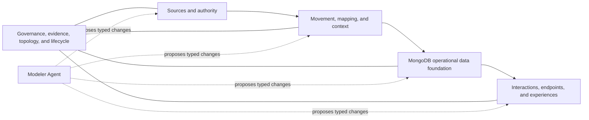

# Outcome catalog, reference architectures, and experience layer

**Status:** implementation baseline
**Date:** 2026-09-27
**Scope:** shared Kehrnel contracts and the hand-off to the Healthcare Data Lab
**Related:** [Builder narrative](./builder-narrative-ui-handoff.md),
[Core evolution](./data-lab-core-evolution.md), and
[Core execution plan](./data-lab-core-execution-plan.md)

## 1. Decision

Add an outcome and reference-architecture layer above Kehrnel's source,
mapping, strategy, and runtime catalogs.

This layer turns the large application matrix into a navigable product
portfolio without pretending that 121 applications already exist. It lets a
visitor begin with an industry outcome, experience a visual demonstration,
inspect the architecture that makes it possible, and open that architecture
as an editable customer project in Builder.

The canonical chain is:

```text
Industry experience
  -> Outcome Pattern
  -> Scenario
  -> Interaction requirements
  -> Data products
  -> Reference Architecture
  -> Source profiles + mappings + Atomic Strategies
  -> Demo Experience
  -> Runtime evidence
```

The customer-specific lifecycle begins only after that discovery path:

```text
Reference Architecture or blank start
  -> Solution Blueprint
  -> Compilation Plan
  -> simulation and review
  -> Release Candidate
  -> approved release
  -> activation and runtime evidence
```

The distinction is essential. A catalog item describes reusable industry
knowledge. A Solution Blueprint captures one customer's mutable intent. A
compiled release is executable. None of these should be represented by the
same object or status badge.

## 2. Product thesis

MongoDB's differentiator is not a gallery of generic industry screens and it
is not a chatbot over a standard API. It is the combination of:

- industry knowledge about the nature, authority, and change patterns of
  operational sources;
- knowledge about how applications, people, workflows, and agents need to
  interact with the resulting data;
- proven MongoDB physical strategies for preserving rich and polymorphic
  documents while serving demanding access patterns at scale;
- deterministic compilation, simulation, approval, and evidence around those
  choices; and
- a visual experience that makes this architecture understandable before a
  customer commits to a deployment.

The document model is the foundation, not the whole proposition. Kehrnel must
show how one governed operational foundation can preserve meaning while
supporting canonical APIs, efficient subject and population queries, search,
vectors, graph traversal, workflows, writes, decision traces, and agent
memory. It should create justified projections when a workload requires one,
not promise that every consumer can efficiently use one universal shape.

## 3. Four artifacts that must remain distinct

### 3.1 Outcome Pattern

An **Outcome Pattern** is a curated, industry-specific description of a useful
business or operational result. It describes:

- who needs the outcome and why;
- one or more recognizable scenarios;
- success measures and service expectations;
- the interactions that must be supported;
- the information and context required;
- likely source categories, without requiring a particular vendor; and
- derived navigation to the architectures and demonstrations that reference
  it.

Examples include cross-facility emergency visibility, longitudinal patient
context for a governed agent, trial-operations oversight, and conversation to
a reviewed clinical record.

An Outcome Pattern is not an executable application and is not a customer
project. The former workbook label **Application** should become **Outcome
Pattern** or **Use-case Pattern** in the product because many rows describe a
workflow, service, command center, agent, or information product rather than
a standalone application.

### 3.2 Reference Architecture

A **Reference Architecture** is a reusable, evidence-backed recommendation for
realizing one or more Outcome Patterns. It connects:

- source categories and known Source Profiles;
- authority and materialization choices;
- ingestion or federation boundaries;
- mappings, identity, terminology, enrichment, provenance, vectors, and other
  context capabilities;
- operational Data Products and justified access structures;
- Atomic Strategies and their exact artifact versions;
- interaction and protocol surfaces;
- expected workloads, topology, tenancy, residency, retention, and SLOs; and
- exact evidence for the reusable assets it claims. Demo Experiences reference
  the architecture separately so the content-addressed graph remains acyclic.

The earlier workbook term **Architecture blueprint** should become **Reference
Architecture**. **Solution Blueprint** remains reserved for the mutable
customer design created by Builder. For v1, **Solution Pattern** is the
portfolio-facing UI label for this same `ReferenceArchitecture` artifact; it
is not a fifth persistent object.

### 3.3 Solution Blueprint

A **Solution Blueprint** is one customer's editable architecture. It may be
created from a Reference Architecture with an immutable
`solution-blueprint-template/v1`, or by starting from a blank need. The
Blueprint records the chosen sources, exact source evidence, required
interactions, policies, workloads, and topology.

The instantiation record—not the retired source-blueprint prototype
contract—preserves the exact Reference Architecture and template references,
the assumptions and their decisions, and a restricted JSON-Pointer override
diff. This keeps current compiler clients compatible while making provenance
auditable. Saving a Blueprint must never modify or silently publish its
reference asset or template.

A Reference Architecture without `blueprintTemplateRef` remains useful for
discovery, but is explicitly `not_instantiable`. Kehrnel must not guess a
concrete source profile, ingestion mode, workload, or topology from source
categories. Instantiation returns either a validated Blueprint or a structured
blocking issue, never an incomplete design disguised as a successful clone.

The hand-off uses four small contracts:

- `solution-blueprint-template/v1` contains complete, deterministic defaults
  and visible assumptions; the typed template catalog rejects duplicate
  artifact versions;
- `reference-architecture-instantiation-request/v1` pins the exact Reference
  Architecture and carries the new Blueprint identity, assumption decisions,
  and restricted `add`/`remove`/`replace` overrides;
- `reference-architecture-instantiation-result/v1` returns either
  `instantiated` with a valid legacy internal source blueprint, or `not_instantiable`
  with a blocking issue. It always echoes `requestedBlueprintId` and
  `requestedRevision` and binds the complete canonical request through
  `requestDigest`; and
- `derivationDigest` covers that request binding, the exact architecture and
  template references, resulting Blueprint, assumptions, decisions,
  overrides, review state, and issues. Only the derivation-digest field itself
  is excluded from that calculation.

Override paths use RFC 6901 JSON Pointers and can modify only the architectural
design roots: sources, context, consumptions, constraints, and preferred
strategies. Identity and provenance are not patchable, and values must belong
to Kehrnel's canonical JSON subset. An override may cite only an assumption
whose declared path overlaps the changed path; an accepted assumption cannot
also be overridden, while a rejected assumption requires a relevant cited
override. Preferred strategies cannot escape the exact strategy set pinned by
the Reference Architecture.

The implemented hand-off publishes three complete templates:

- `template.healthcare.openehr-cdr-starter@1.0.0` uses the exact openEHR
  exchange Source Profile and primary `openehr.rps_dual` strategy for canonical
  AQL and population access;
- `template.healthcare.fhir-repository-starter@1.0.0` uses the exact FHIR R4
  exchange Source Profile and `fhir.resource_store` for
  CapabilityStatement-bounded create, update, read, search, and bounded indexed
  population filtering; and
- `template.pharmaceutical.cdisc-sdr-starter@1.0.0` uses the exact CDISC
  Dataset-JSON 1.1 exchange Source Profile and `cdisc.sdr` for controlled
  intake, bounded `cdisc-query/v1` access, lineage inspection, and reviewed
  snapshot export.

These are deterministic, non-executing Builder defaults. The FHIR starter does
not claim broad R4 conformance, latency, analytics export or event streaming,
or an activated R4 environment. The CDISC starter does not claim an EDC or
LIMS connector, every exchange format, submission authoring, regulatory
conformance, unrestricted MongoDB or statistical access, or optional semantic
and AI infrastructure. Unresolved assumptions still require review.

`POST /v1/reference-architectures/{architecture_id}/instantiate` derives a
valid Blueprint and verifies it through the existing source-aware compiler.
The operation creates no project, collection, index, connector, or activation.
Reference Architectures without an equally complete template return a
structured `not_instantiable` result. Template content integrity and
architecture compatibility are rechecked for each instantiation, and cached
catalogs are returned as isolated copies. A missing or invalid pinned template,
or an unavailable compiler catalog, fails closed as a stable dependency error
rather than being treated as a customer design problem.

### 3.4 Demo Experience

A **Demo Experience** is a versioned, read-only story that makes an Outcome
Pattern and its Reference Architecture visible. It includes:

- the audience and scenario;
- the interactions the visitor performs;
- the visible result and failure path;
- optional synthetic fixture and completed-run evidence references;
- the architecture steps illuminated during the story; and
- measured, simulated, estimated, or illustrative evidence.

A storyboard is not proof of execution. A Demo Experience can be a concept,
but the UI must never render a concept as if a live connector, mapping, query,
or application had run. In the contract, a Demo Experience at `simulated` or
higher maturity must carry both `fixturePackRefs` and `runEvidenceRefs`; a
storyboard or general `evidenceRefs` entry is not a substitute for either.

## 4. One portfolio, three complementary ways to enter

The experience should support three starts without creating three products:

1. **Start from an outcome.** Choose a known Outcome Pattern, experience its
   demo, inspect the Reference Architecture, and open it in Builder.
2. **Start from a source landscape.** Select known categories or profiles,
   then ask what outcomes and architectures they can support.
3. **Start from a need.** Describe the intended users, decisions, interactions,
   scale, freshness, and policies. The Modeler Agent proposes structured
   Outcome Pattern and Blueprint changes for review.

All three paths converge on the same Solution Blueprint contract. Natural
language complements graphical controls; it does not create a second hidden
model of the project.

Healthcare and Pharmaceutical use separate public doors, vocabularies,
examples, category maps, and portfolios. They share the contracts, compiler,
and runtime behind the scenes. The visitor should first feel that MongoDB
understands their industry, then discover the shared platform.

## 5. Builder canvas

The Builder should make the architecture itself the central object. A useful
canvas has four left-to-right zones and one persistent foundation:



### Sources and authority

Each source card identifies its business category, optional known product,
Source Profile, tenant/facility/location, authority, data ownership, change
mechanism, sensitivity, and evidence. A source can be:

- an existing system retained as authoritative;
- a database or API discovered from customer evidence;
- a standards-native feed;
- a synthetic or simulated source; or
- a new domain that MongoDB will own from inception.

CDC, batch, APIs, events, and federation are integration choices. The customer
or a partner may supply the physical connector. Kehrnel still records the
contract, authority, cursor/idempotency expectations, lineage, and evidence
required for a trustworthy architecture.

### Movement, mapping, and context

This zone makes transformation explicit: extraction, joins, normalization,
identity, direct mappings, semantic-assisted mappings, terminology bindings,
enrichment, provenance, document knowledge, graph links, and embeddings.

A common semantic map is optional. It may improve mapping proposals and
cross-source understanding, but it is not an obligatory hub through which all
data must pass. A direct, reviewed, typed mapping remains valid when it is the
simpler and safer design.

### MongoDB operational data foundation

This is the project being designed, not another source card. It shows
authoritative aggregates, preserved canonical documents, derived views,
decision traces, workflow state, memories, collection boundaries, tenancy,
indexes, Search/Vector Search definitions, graph relationships, retention,
archive policy, and rebuild/retirement rules.

The compiler must first test whether the authoritative document plus indexes
can satisfy the workload. Derived structures are introduced only with a named
consumer, consistency policy, lineage, rebuild path, cost, and retirement
condition.

### Interactions, endpoints, and experiences

The right side represents what people, applications, processes, and agents can
do—not just how they read. It can include FHIR search, openEHR REST/AQL, CDISC,
MQL/aggregation, cohorts, Search, vectors, graph traversal, events, analytical
exports, governed tools, workflow commands, and rich applications.

Writes declare their authority and destination explicitly: back to a source,
to an authoritative MongoDB object, to workflow state, to an append-only
decision trace, to an agent-memory store, or to another governed artifact.

### Three synchronized lenses

The same graph should support progressive disclosure rather than separate
incompatible diagrams:

- **Outcome lens:** actors, scenarios, decisions, and visible experiences;
- **Logical lens:** sources, Data Products, mappings, context, and interaction
  contracts; and
- **Physical lens:** collections, indexes, partitions, change streams, APIs,
  topology, evidence, and operational status.

Selecting a node should keep it selected while the user moves between lenses.
This lets an executive understand the story and an engineer inspect why a
MongoDB structure exists without losing context.

## 6. Interaction requirements: beyond consumption

`Consumption` is too narrow for systems that enrich, act, coordinate, and
remember. Each scenario should declare one or more interaction requirements
using an effect independent from its level of autonomy.

| Effect | Meaning | Typical persisted result |
| --- | --- | --- |
| Retrieve | Read records, search, assemble context, or identify a cohort | Optional reproducible query manifest |
| Subscribe | Observe changes or domain events | Cursor, checkpoint, and delivery evidence |
| Enrich | Classify, reconcile, calculate, enrich, or link | Derived facts, annotations, confidence, provenance |
| Command | Create or change an authorized business object | Business change and execution receipt |
| Coordinate | Advance a process across people and services | Workflow state, ownership, checkpoints |
| Record decision | Preserve recommendation, evidence, choice, action, and outcome | Append-only decision trace |
| Remember | Retain reviewed information for later tasks | Scoped episodic, semantic, or procedural memory |
| Improve | Assess an outcome or candidate improvement | Evaluation evidence and review proposal |

Autonomy is a separate dimension:

- **direct application** — a person or deterministic application chooses the
  operation;
- **agent assisted** — an agent investigates or proposes and a person decides;
- **bounded autonomous** — an agent selects and executes allowlisted actions
  within policy and approval limits; or
- **continuous agent** — an agent monitors events, pursues a bounded objective,
  acts, observes outcomes, and resumes over time.

Write capability does not imply autonomy. A traditional scheduling application
can write; a sophisticated investigative agent can remain read-only. Every
write declares authority, policy, approval, idempotency, audit, and rollback or
compensation behavior.

Memory also needs explicit types and lifecycles:

- working state for resuming an interrupted activity;
- evidence and decision traces for explaining an action;
- reviewed reusable memory for future tasks; and
- model or procedure improvement proposals that require evaluation and
  approval before changing behavior.

An inferred preference, a confirmed clinical fact, and a lesson from an
operational incident must never become indistinguishable records.

## 7. Catalog contract and graph

The initial read contract is `industry-outcome-catalog/v1`, exposed by:

```text
GET /v1/outcome-catalog
```

The first implementation publishes one deterministic, content-addressed
catalog document. Its top-level `artifactRef` must identify the
`industry-outcome-catalog`, and its ID and version must equal `catalogId` and
`version`. In addition to typed `OutcomePattern`, `ReferenceArchitecture`, and
`DemoExperience` records, the document carries typed definitions for portfolio
domains, Data Products, architecture capabilities, and visual patterns. These
are the normalized D/P/B/V dimensions from the workbook, not opaque display
codes:

```text
artifactRef, catalogId, version
domains[]                  -> PortfolioDomainDefinition      (D*)
dataProducts[]             -> DataProductDefinition         (P*)
architectureCapabilities[] -> ArchitectureCapabilityDefinition (B*)
visualPatterns[]           -> VisualPatternDefinition       (V*)
outcomes[]                 -> OutcomePattern
referenceArchitectures[]   -> ReferenceArchitecture
demoExperiences[]          -> DemoExperience
```

Every definition and portfolio record is itself versioned and
content-addressed. Stable identifiers and explicit references are more
important than premature service separation. Later, HDL can own presentation
and tenant publication metadata while Kehrnel continues to own executable
strategy and evidence truth, joined through the Catalog Aggregation API
described in the Core evolution design.

The catalog must support these relationships:

```text
Outcome Pattern --has--> Scenario
Scenario --requires by interactionIds--> Interaction Requirement
Interaction Requirement --reads/writes--> Data Product
Reference Architecture --realizes--> Outcome Pattern
Reference Architecture --accepts by exact ref--> Source Category / Source Profile
Reference Architecture --uses--> Mapping / Semantic Asset / Atomic Strategy
Reference Architecture --offers--> Interaction Requirement or profile
Demo Experience --demonstrates--> Outcome Pattern / Reference Architecture
Demo Experience --may use--> fixture plus completed-run evidence
```

Scenarios use required `interactionIds` that resolve inside their Outcome
Pattern. Outcome Patterns use validated local D/P IDs. Reference Architectures
use exact `sourceCategoryRefs`, `sourceProfileRefs`, `mappingRefs`,
`strategyRefs`, and Outcome Pattern references; Demo Experiences use exact
Outcome Pattern and Reference Architecture references. Data Products and
architecture capabilities provide reverse navigation with exact Outcome
Pattern references. To keep content-addressed records acyclic, architecture
and demo back-links are not authored on the Outcome Pattern. The browser must
not infer relationships from matching labels.

The catalog endpoint is a read model, not a deployment API. Choosing a
Reference Architecture may create a new Solution Blueprint only when the
architecture pins an exact Blueprint Template. The deterministic
instantiation result carries its own derivation digest, exact origin references,
assumptions, decisions, overrides, review requirement, and issues. It does not
produce a Compilation Plan, persist a project, or activate anything. Kehrnel
does run the derived Blueprint through the existing source-aware compiler as a
fail-closed validation step; a blocking compiler result becomes
`not_instantiable` rather than an apparently valid design.

## 8. Migrating the industry matrix

The Numbers workbook is valuable editorial research. It is not a runtime
source of truth. Its content should migrate as follows:

| Workbook concept | Canonical destination |
| --- | --- |
| Applications | Outcome Patterns |
| Application description and visual outcome | Scenario and experience summary |
| Demo stories | Demo Experiences |
| Architecture blueprints | Reference Architectures |
| Data products | Versioned Data Product definitions |
| Consumption profiles | Interaction requirements/profiles |
| Architecture capabilities | Capability references and claims |
| Source fixture packs | Demo-pack and Source Profile references |
| Terminology assets | Semantic/terminology artifact references |
| Worked examples | Lighthouse candidates with review evidence |

The current workbook contains 121 useful candidates, but they are uniformly
draft concepts rather than 121 committed builds. The current catalog imports
all of them as discoverable concepts with these constraints:

- their editorial status remains explicit;
- a concept carries no executable implication;
- relationships are validated rather than encoded only as spreadsheet cells;
- generic decision, memory, or agent features are not assigned to every
  outcome by default;
- only reviewed Reference Architectures carry exact strategy or mapping
  evidence references; and
- Demo Experience fixture and completed-run references remain empty until the
  corresponding assets and executions exist.

The workbook should remain a review and planning export if useful. Future
spreadsheets and UI tables should be generated from the normalized catalog,
not become parallel authorities.

## 9. Maturity and claim truth

Do not create one vague lifecycle field that mixes editorial completeness,
support, runtime availability, and execution. Reuse the Core dimensions:

- package lifecycle;
- capability maturity;
- support status;
- runtime availability;
- execution state; and
- observation kind.

The public experience may summarize those claims as:

- **Available now** — required capabilities are executable and have matching
  supported evidence;
- **Guided proposal** — the architecture is specified, compilable, or
  simulated but still requires mapping, policy, approval, or validation; and
- **Planned** — the destination is useful to explain but lacks a complete
  executable path.

The summary must be derived server-side and expose its contributing and
blocking claims. An executable target strategy does not make a full
source-to-application journey executable. For example, a live openEHR target
plus a simulated OpenMRS laboratory mapping still yields a guided end-to-end
journey unless every required step has matching runtime evidence.

The first `industry-outcome-catalog/v1` read-model slice exposes each record's
raw `capabilityMaturity`, `supportStatus`, `publicationStatus`, and
`evidenceRefs`. It does not yet implement the aggregate badge or
contributing/blocking-claim response. Until the next KDL-014 increment adds
that server-side derivation, the UI must show the raw state and must not infer
**Available now** from a linked strategy on its own.

The seed currently contains 121 draft Outcome Patterns, nine Reference
Architectures, and nine Demo Experiences. All nine demos are `specified` and
`evaluation_only`, with no `fixturePackRefs` or `runEvidenceRefs`. Some linked
architectures have executable or simulated lower-level evidence, but that does
not promote the visual end-to-end demo. Creating runnable fixture packs,
recording completed runs, and then promoting individual demos are explicit
next increments.

Blueprint instantiation is compilation evidence, not runtime or Demo Experience
evidence. The FHIR exchange Source Profile is `pilot_validated`; the CDISC
Dataset-JSON Source Profile is conservatively `specified`. Their linked demos
remain `specified` and `evaluation_only`, with no fixture or completed-run
evidence.

## 10. Lighthouse portfolio

The catalog is broad; delivery must be deliberately narrow. The recommended
order is:

| Industry door | Lighthouse | First honest position |
| --- | --- | --- |
| Healthcare | OpenMRS/Bahmni laboratory interaction to openEHR RPS Dual, then AQL and cohort use | Primary proof. Target strategy executable; bounded mapping simulated; full source route gated by evidence. |
| Healthcare | FHIR store at operational scale with canonical search and population access | Compiler-ready R4 Builder starter for bounded native REST and search; minimal R4 scope and demo/run evidence remain explicit gaps. |
| Healthcare | Cross-facility emergency demand and waiting-time visibility | Outcome-led guided proposal; specified first, with deterministic simulation as the next proof. |
| Healthcare | Equipment and capacity operations | Planned portfolio expansion; validates that the proposition is not only clinical. |
| Healthcare | Conversation to governed clinical record | Planned agentic write story with human review, terminology, provenance, and trace. |
| Pharmaceutical | CDISC study data access and trial-operations context | Compiler-ready Dataset-JSON starter for governed study query and reviewed export; connectors, validation and regulatory claims, optional semantic/AI infrastructure, and demo evidence remain separate. |
| Pharmaceutical | Protocol feasibility and study cohort planning | Guided proposal using protocol, terminology, cohort, and evidence contracts. |
| Pharmaceutical | Batch release, deviation, and quality investigation | Planned expansion proving the shared platform beyond clinical data. |

`openehr.rps_dual` and its `openehr.rps_dual_ibm` exact-model profile remain the
primary release-blocking implementation. FHIR Resource Store and CDISC SDR are
supported follow-up strategies with compiler-ready Builder hand-offs, not the
primary runtime proof. Preview packages remain visible only when their maturity
and missing evidence are explicit.

## 11. Complete work scope

### P0 — Establish the portfolio contract

**Kehrnel/Core**

- define and publish `industry-outcome-catalog/v1`;
- normalize the candidate catalog into stable IDs and typed relationships;
- expose `GET /v1/outcome-catalog` with deterministic ordering and schemas;
- validate referential integrity, duplicate IDs, maturity claims, and artifact
  digests;
- link lighthouse records to the existing source categories, Source Profiles,
  mappings, Atomic Strategies, fixtures, and evidence;
- preserve the rest of the catalog as honest editorial concepts;
- add golden success and degraded/unsupported fixtures for UI development; and
- provide filters without making one mixed Healthcare/Pharmaceutical landing.

**Healthcare Data Lab / UI**

- render separate Healthcare and Pharmaceutical portfolio doors;
- add Outcome Pattern cards, detail pages, and architecture/evidence summaries;
- show raw Core maturity, support, publication, and evidence truth in the first
  slice, then use server-derived Available now, Guided proposal, and Planned
  states when the next KDL-014 increment exposes them;
- provide `Open in Builder` only where the hand-off contract is valid; and
- never hardcode strategy support or invent links from labels.

**Industry content owners**

- review names, actors, success measures, failure cases, and source categories;
- assign accountable owners and portfolio priority;
- identify terminology, licensing, synthetic-data, and validation needs; and
- select the first five Healthcare and three Pharmaceutical lighthouse stories.

### P1 — Close the gallery-to-Builder loop

- extend the implemented immutable Blueprint Template catalog only for
  architectures that have enough source, ingestion, consumption, workload,
  and policy detail to instantiate; the current catalog contains the openEHR,
  FHIR, and CDISC starters, and further templates require equally complete
  defaults;
- build on the implemented exact Reference Architecture to Solution Blueprint
  instantiation contract with version pins, assumptions, decisions,
  restricted override diff, deterministic digest, compiler validation, and
  structured non-instantiable results;
- model interaction effects, autonomy, write targets, decision traces, and
  memory policies explicitly;
- let the canvas edit sources, context, operational structures, and
  interactions while preserving one graph identity across all lenses;
- add a Modeler Agent seam that produces typed proposals with confidence,
  assumptions, alternatives, and affected artifacts;
- require deterministic validation, simulation, and human approval for every
  accepted proposal;
- return a Compilation Plan with selected and rejected strategies, required
  evidence, and unsupported requirements; and
- preserve a blank-start path that converges on the same Blueprint contract.

### P2 — Prove lighthouse experiences

- complete the OpenMRS/Bahmni-to-openEHR mapping and interaction evidence needed
  for the first end-to-end story;
- keep `openehr.rps_dual_ibm` in the release-blocking validation matrix;
- package deterministic source interactions, snapshots, events, mappings,
  expected queries, visual outcomes, and reset instructions;
- connect each Demo Experience step to the exact architecture node and runtime
  evidence it demonstrates;
- prove subject AQL, multi-patient/cohort access, and one governed agent tool
  without reducing the story to natural-language querying;
- add a separately evidenced FHIR path and a CDISC Pharmaceutical path; and
- use emergency flow as the first broad operational simulation after the
  clinical foundation is credible.

### P3 — Make discovery and customization real

- import customer Source Profile observations from Context Studio without raw
  sensitive data;
- support polymorphic family, semantic-match, terminology-binding, and mapping
  proposals as typed reviewable diffs;
- add connectors or connector contracts only where a lighthouse needs them;
- permit direct mapping when a semantic intermediary adds no value;
- make tenant-created patterns private by default and publication a separate
  reviewed action;
- preserve provenance from previous reference knowledge without treating a
  historical architecture as proof for a new source; and
- evaluate model proposals for mapping accuracy, false matches, schema drift,
  prompt injection, and unsupported inputs.

### P4 — Release and operate

- compile deterministic, content-addressed Release Candidates;
- approve exact candidate digests and activate them into explicit tenant and
  environment boundaries;
- manage connection bindings, CDC checkpoints, mapping coverage, drift,
  freshness, SLOs, cost, release history, rollback, and evidence;
- support multi-tenant, multi-facility, residency, federation, and archival
  policy;
- observe access structures and propose safe optimization or retirement; and
- feed approved runtime learning into a new Blueprint revision, never directly
  into a running release.

### Continuous — Portfolio governance

- review candidate Outcomes rather than attempting to build all 121;
- deduplicate overlapping scenarios and extract reusable Data Products,
  interactions, and Reference Architectures;
- require named ownership and evidence before promotion;
- keep Healthcare and Pharmaceutical language distinct while reusing shared
  backend artifacts; and
- publish exports for editorial review from the catalog authority.

## 12. Acceptance for the first coherent slice

The first slice is complete when:

1. the versioned catalog validates and returns deterministic content;
2. every referenced ID resolves and every executable reference is versioned;
3. all imported matrix candidates are visibly concepts unless reviewed;
4. one Healthcare lighthouse links the outcome, scenario, interaction
   requirements, Data Products, Reference Architecture, source/mapping/strategy
   evidence, and Demo Experience;
5. the target strategy's executable status is not incorrectly inherited by a
   simulated or planned source-to-outcome path;
6. Healthcare and Pharmaceutical can be filtered into independent experience
   catalogs without duplicating backend definitions;
7. HDL can render the portfolio and open an exact architecture in Builder from
   a committed fixture; and
8. unsupported or missing evidence is returned as structured data rather than
   repaired by UI copy.

## 13. Explicit non-goals

- Do not build 121 production applications.
- Do not turn the matrix workbook into a production database.
- Do not make standards or vendors the top-level portfolio hierarchy.
- Do not require a universal semantic map for every mapping.
- Do not make MongoDB replace the customer's complete application estate.
- Do not claim that a connector exists because a source category is modeled.
- Do not permit an agent to mutate a Blueprint or release from prose alone.
- Do not present one generic Health and Life Sciences landing experience.
- Do not create derived MongoDB projections without a workload, lineage,
  rebuild, and retirement contract.
- Do not confuse a compelling visual concept with measured runtime evidence.

## 14. Intended audience journey

A functional visitor should be able to:

1. recognize an outcome in the language of their industry;
2. experience a compelling, honest demonstration;
3. reveal the sources, operational products, and interactions beneath it;
4. understand why MongoDB is used and which parts are live;
5. open the Reference Architecture as a project;
6. adapt sources, context, writes, endpoints, workloads, and policies with the
   Modeler Agent and direct controls; and
7. simulate, review, save, and eventually operate an approved implementation.

That journey is the bridge between an application gallery, the composable
Builder, and Kehrnel's execution evidence. It is also the most defensible way
to communicate the larger vision: not a collection of disconnected demos, but
an industry architecture system that learns from proven MongoDB strategies and
recomposes them for each customer's real operational and agentic needs.
